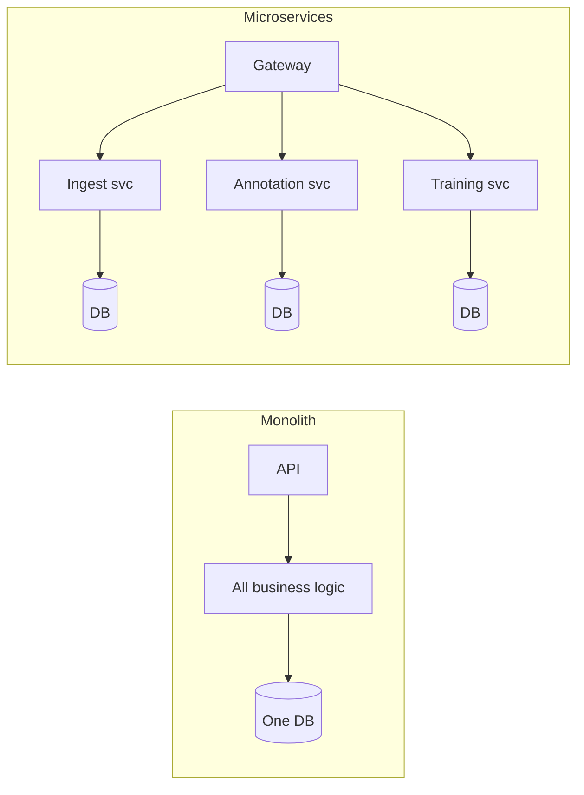
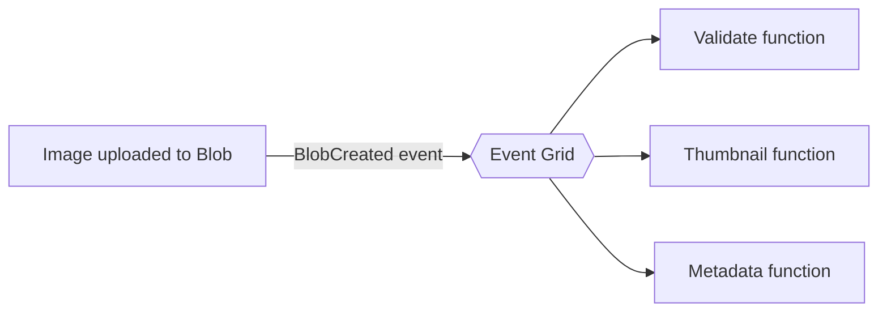

> [!summary] In one line
> An architecture style is the overall shape of a system: how it is split into deployable parts and how those parts talk. Each style buys some qualities by paying with others.

## The idea

Before you pick frameworks or clouds, you pick a **shape**. The five styles worth knowing cold:

| Style | Shape | Deploys as |
| --- | --- | --- |
| **Monolith** | One codebase, one process, one database | One unit |
| **Modular monolith** | One deployable, but split into modules with enforced boundaries | One unit |
| **Microservices** | Many small services, each owning its own data | Many units, independently |
| **Event-driven** | Components react to events published by others; producers don't know consumers | Usually many units |
| **Serverless** | Functions triggered by events, run and scaled by the cloud provider | Many small functions |

These overlap. A system can be event-driven *and* serverless (Azure Functions triggered by Blob events), or a modular monolith that publishes events.

## How it works

**What each style is good at**

- **Monolith:** simplest to build, test, debug and deploy. Transactions are easy because there's one database. It hurts when many teams change the same code, or when one part needs to scale very differently from the rest.
- **Modular monolith:** keeps the monolith's simplicity but draws hard module boundaries (separate packages, no reaching into another module's tables). It's often the **right default**, and it can be split into services later along the module lines.
- **Microservices:** independent deployment and scaling per service, team autonomy, and freedom to choose technology per service. The cost is a distributed system: network failures, data consistency across services, harder debugging, and much more DevOps.
- **Event-driven:** very loose coupling and natural fit for "something happened, several things should react". Harder to see the end-to-end flow; you need good tracing and idempotent consumers (see [[09 Idempotency, Retries and Timeouts]]).
- **Serverless:** no servers to manage, pay per execution, scales to zero. Limits on execution time and memory, cold starts, and vendor lock-in.

## On the platform

A machine-vision platform usually ends up **hybrid**:

- **Serverless + event-driven** at the edges: an image landing in Blob Storage triggers Azure Functions for validation and metadata extraction.
- **Pipelines** (Kubeflow on Kubernetes) for long, heavy, GPU-bound work such as training and batch inference, which doesn't fit serverless time limits.
- **A few services** (for example a FastAPI API) for things users and tools call directly: dataset queries, job status, model registry lookups.

When someone proposes "let's make it microservices", the right question is: *which part needs to deploy or scale independently, and which team owns it?* If there's no clear answer, a modular monolith is cheaper.

## Trade-offs

| Choose… | When… | Avoid when… |
| --- | --- | --- |
| Monolith / modular monolith | One or two teams, early product, domain still changing | Parts need very different scaling or release cadence |
| Microservices | Several teams, clear domain boundaries, strong DevOps | Small team, unclear boundaries, weak CI/CD and observability |
| Event-driven | Many consumers react to the same fact; producers must not wait | You need an immediate answer, or strict ordering everywhere |
| Serverless | Spiky, short, event-triggered work | Long-running (> minutes), GPU, or steady high load |

## Common mistakes

- **Distributed monolith:** microservices that share a database or must deploy together. You get all the costs and none of the benefits.
- Choosing microservices for "scalability" when a single well-indexed service would handle the load easily.
- Running long training jobs in Functions and fighting timeouts instead of using a job/pipeline runner.
- Event-driven systems with no correlation ID, so nobody can trace what happened to one image.

## Check yourself

> [!question]- What is the difference between a monolith and a modular monolith?
> Both deploy as one unit. A modular monolith enforces **internal boundaries**: modules expose clear interfaces and don't touch each other's data. That keeps the code changeable and makes a later split into services possible.

> [!question]- What is a "distributed monolith" and why is it bad?
> Services that are separately deployed but tightly coupled: shared database, synchronous call chains, lockstep releases. You pay network and operational costs without gaining independent deployment.

> [!question]- Why isn't model training a good fit for Azure Functions?
> Training is long-running, memory- and GPU-heavy, and often needs checkpoints. Functions have execution time limits and aren't designed for GPU workloads; a pipeline or job runner on Kubernetes fits better.

> [!question]- Name one thing event-driven style makes harder.
> End-to-end visibility and debugging (the flow isn't in one place), plus handling duplicate or out-of-order events.

## Apply it

- [ ] Label each major part of the real platform with its style (serverless, pipeline, service, UI). Is the overall system one style or a hybrid?
- [ ] Find one place where two parts share a database. Is that a deliberate choice?

## Go deeper

- [Azure: Architecture styles](https://learn.microsoft.com/en-us/azure/architecture/guide/architecture-styles/)
- [Martin Fowler: Monolith First](https://martinfowler.com/bliki/MonolithFirst.html)
- [Martin Fowler: Microservices](https://martinfowler.com/articles/microservices.html)

**Related:** [[02 Layered and Hexagonal Architecture]] · [[05 Sync vs Async Communication]] · [[04 Quality Attributes]]
