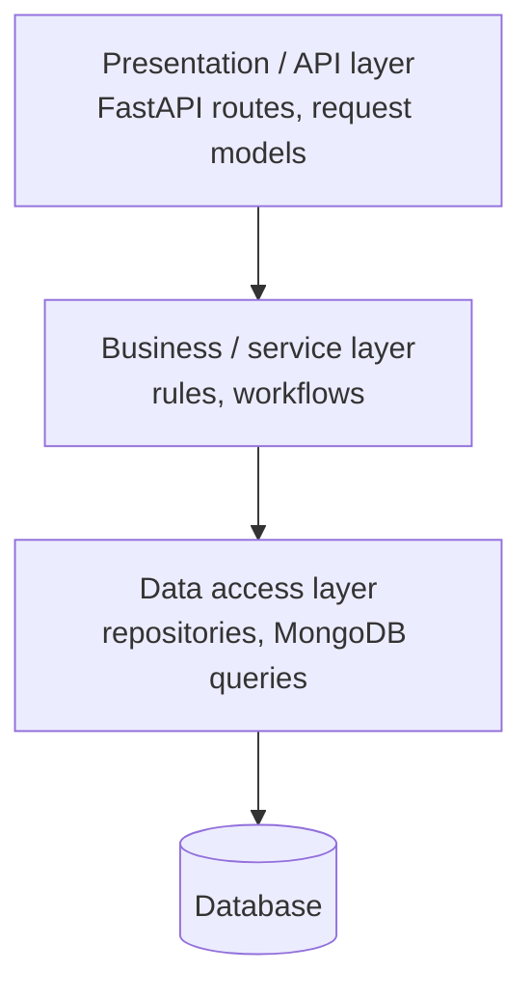
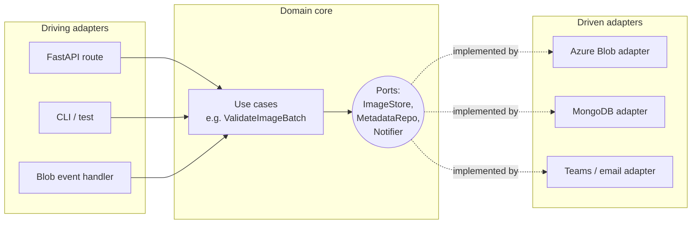

> [!summary] In one line
> Layered architecture stacks code by responsibility (API → logic → data). Hexagonal architecture puts the business logic in the centre and plugs everything else (APIs, databases, queues) in through *ports* and *adapters*.

## The idea

[[01 Architecture Styles|Architecture styles]] decide how the *system* is split. These patterns decide how the code *inside one service* is organised. The goal of both: **keep the core rules of the domain from depending on details** such as FastAPI, MongoDB or Azure SDKs.

## How it works

### Layered (n-tier)



Each layer only calls the layer below. It's familiar and easy to start with. The weak spot: business logic still **depends on** the data layer, so database details leak upward, and tests of the logic often need a database.

### Hexagonal (ports and adapters)



- **Ports** are interfaces the core defines in its own language, e.g. `ImageStore.get(image_id)`.
- **Adapters** implement those ports for a specific technology: one for Azure Blob, one in-memory fake for tests.
- **Dependencies point inward.** The core imports nothing from FastAPI, PyMongo or Azure SDKs.

*Clean Architecture* and *Onion Architecture* are close relatives of the same idea: concentric rings, dependencies pointing to the centre.

### In Python, briefly

```python
# core/ports.py: the core defines what it needs
from typing import Protocol

class ImageStore(Protocol):
    def read(self, image_id: str) -> bytes: ...

# core/use_cases.py: pure logic, easy to test
def validate_image(store: ImageStore, image_id: str) -> list[str]:
    data = store.read(image_id)
    errors = []
    if len(data) == 0:
        errors.append("empty file")
    return errors

# adapters/blob_store.py: technology lives at the edge
class BlobImageStore:
    def __init__(self, container_client): self.c = container_client
    def read(self, image_id: str) -> bytes:
        return self.c.download_blob(image_id).readall()
```

A test passes a fake `ImageStore` holding bytes in a dict. No Azure, no network.

## On the platform

- The same validation logic can be driven by **an Azure Function** (Blob trigger), **a FastAPI endpoint** (manual re-validate) and **a pytest test**, because they're just three driving adapters.
- Swapping storage (Blob → local disk for a demo, or a different annotation tool than V7) means writing a new adapter, not touching the rules.
- This is also where the **QA background pays off**: hexagonal design makes the core testable without infrastructure, which is exactly what quality gates need.

## Trade-offs

| Layered | Hexagonal |
| --- | --- |
| Quick to start, familiar to everyone | More files and interfaces up front |
| Logic tends to depend on the DB layer | Core is independent and easy to unit test |
| Fine for CRUD-heavy services | Worth it when business rules are real and long-lived |

## Common mistakes

- Creating ports for everything in a tiny CRUD service: ceremony without benefit.
- "Leaky" core: returning MongoDB documents or Azure SDK objects from the domain layer.
- Putting business rules in FastAPI route functions, so nothing can reuse them.

## Check yourself

> [!question]- In hexagonal architecture, which direction do dependencies point?
> Inward. Adapters depend on the core's ports; the core depends on nothing technology-specific.

> [!question]- What is the difference between a driving and a driven adapter?
> **Driving** adapters call into the core (API routes, event handlers, CLIs, tests). **Driven** adapters are called by the core through ports (databases, storage, messaging, email).

> [!question]- Why does hexagonal architecture make testing easier?
> You can replace driven adapters with in-memory fakes, so use cases run in milliseconds without databases or cloud services.

## Apply it

- [ ] In the capstone (December), create folders `core/`, `adapters/`, `api/`. Keep `core/` free of FastAPI and Azure imports.
- [ ] Pick one team repo and check: do route handlers contain business rules?

## Go deeper

- [Alistair Cockburn: Hexagonal Architecture](https://alistair.cockburn.us/hexagonal-architecture/)
- [Azure: N-tier architecture style](https://learn.microsoft.com/en-us/azure/architecture/guide/architecture-styles/n-tier)

**Related:** [[03 Coupling and Cohesion]] · [[01 Architecture Styles]]
