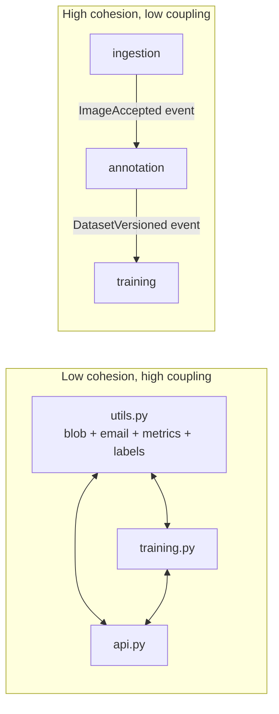

> [!summary] In one line
> Put things that change together in the same place (**high cohesion**), and keep the places as independent as possible (**low coupling**). Separation of concerns is the habit that gets you there.

## The idea

- **Separation of concerns:** each part of the system has one job. Ingestion doesn't know about training; the API layer doesn't contain business rules.
- **Cohesion:** how strongly the things *inside* a module belong together. High cohesion = one clear purpose.
- **Coupling:** how much one module depends on *another*. Low coupling = you can change one without changing the other.

A good boundary gives you **high cohesion inside, low coupling across**. This applies at every level: functions, classes, modules, services, even teams.

## How it works

### Kinds of coupling (from worse to better)

| Kind | Example | Why it hurts |
| --- | --- | --- |
| **Shared database** | Training reads the annotation service's MongoDB collections directly | Any schema change breaks someone else |
| **Temporal** | Service A must call B synchronously and wait | A fails when B is down (see [[05 Sync vs Async Communication]]) |
| **Data format** | Everyone parses the V7 export JSON themselves | Change the export, break every consumer |
| **Contract (API / event schema)** | Services talk only through a versioned API or event | Healthy: change is negotiated and visible |

### Connascence, in one sentence

A useful extra lens: two parts are *connascent* if changing one forces a change in the other. The goal is to keep strong connascence **inside** a module and only weak connascence (names, simple types) **across** modules.

## On the platform

Natural boundaries in a vision pipeline follow the **lifecycle**:

1. **Ingestion:** receive images, validate, store, record metadata.
2. **Annotation:** send to V7, track batches, import labels, quality checks.
3. **Dataset management:** version datasets, splits, lineage.
4. **Training and evaluation:** pipelines, metrics, model registry.
5. **Deployment and monitoring:** serving, drift, feedback.

Each stage hands the next a **well-defined artefact** (an accepted image record, a versioned dataset, a registered model). That artefact is the contract. If the training code reaches into annotation's internal tables, that's a coupling smell to raise in design review.

## Trade-offs

- Splitting too finely creates **chatty** boundaries: lots of calls for one operation, so coupling moves to the network.
- Splitting too coarsely creates **god modules** that everyone has to change.
- Rule of thumb: draw boundaries where the **reasons to change** differ (different teams, different release cadence, different data).

## Common mistakes

- A `common` or `utils` package that grows until everything depends on it.
- Sharing database tables "just for reporting", and that becomes the real integration.
- Copy-pasting a data model into every service instead of publishing a contract.

## Check yourself

> [!question]- Define cohesion and coupling in one sentence each.
> Cohesion: how closely related the responsibilities inside a module are. Coupling: how much one module depends on the internals of another.

> [!question]- Why is a shared database the strongest form of coupling between services?
> The schema becomes a hidden, unversioned contract. Any change can break other services, and nobody can deploy or migrate independently.

> [!question]- How would you decide where to draw a service boundary?
> Around a cohesive business capability with its own data and its own reasons to change, ideally owned by one team, communicating through explicit contracts.

## Apply it

- [ ] List the artefacts that pass between lifecycle stages on the real platform. Which have an explicit schema and which are "whatever the JSON looks like"?
- [ ] Find one shared table or collection, and note who reads and writes it.

## Go deeper

- *Designing Data-Intensive Applications*, Ch. 4 (encoding and evolution of data contracts)
- [Martin Fowler: Bounded Context](https://martinfowler.com/bliki/BoundedContext.html)
- [connascence.io](https://connascence.io/)

**Related:** [[02 Layered and Hexagonal Architecture]] · [[01 Architecture Styles]] · [[09 Trade-off Analysis]]
