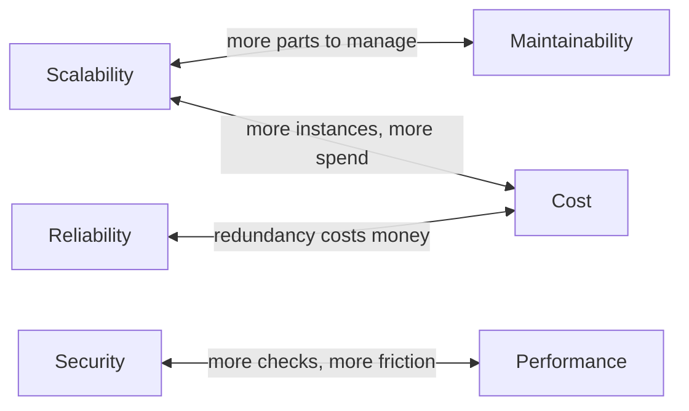

> [!summary] In one line
> Features say *what* a system does; quality attributes say *how well* it does it. Architecture is mostly about choosing which qualities matter most and paying for them.

## The idea

Two systems can have identical features and completely different architectures, because they need different qualities. The five that matter most for the roadmap:

| Attribute | Question it answers | Typical measure |
| --- | --- | --- |
| **Scalability** | Can it handle more load by adding resources? | Throughput (images/hour), latency at peak |
| **Reliability** | Does it keep working correctly when things fail? | Availability %, error rate, successful pipeline runs |
| **Maintainability** | Can people understand and change it safely? | Lead time for changes, change failure rate, onboarding time |
| **Security** | Is it protected against misuse and data leaks? | Findings, least-privilege coverage, secrets in Key Vault |
| **Cost** | Is it affordable to run and grow? | Cost per 1,000 images, GPU-hours per model |

Others worth recognising: **performance** (latency), **availability**, **observability**, **testability**, **portability**, **compliance**.

## How it works

### Make them measurable

"It should be fast" is not a requirement. Write a **quality attribute scenario**:

> When **200 images per minute** arrive (stimulus) during a **warehouse shift peak** (environment), the **ingestion stage** (artefact) **validates and stores them** (response) with **p95 under 5 seconds and zero lost files** (measure).

That sentence can be tested, monitored and argued about. See [[01 Requirements]] for the full format.

### They pull against each other

You can't maximise all of them. A good architect names the **top two or three** for a system and accepts weaker results elsewhere. [[09 Trade-off Analysis]] shows how to compare options against them.

### Microsoft's version: Well-Architected pillars

The Azure Well-Architected Framework groups them into five pillars: **Reliability, Security, Cost Optimization, Operational Excellence, Performance Efficiency**. It's worth learning because onshore architects and AZ-305 both use this language.

## On the platform

For a machine-vision platform, a sensible ranking might be:

1. **Reliability of data:** no image or label silently lost or corrupted. A bad dataset poisons every model trained on it.
2. **Maintainability:** the pipeline changes constantly as models and annotation needs evolve.
3. **Cost:** GPU training and annotation are the big bills; storage tiers matter at 3D data volumes.
4. **Scalability:** usually bursty (a new site sends a big batch), not constant.
5. **Security:** customer warehouse images may be sensitive; access control on Blob containers and secrets matter.

These map directly onto the **platform KPIs** in the roadmap: turnaround time (performance/scalability), annotation cost per batch (cost), evaluation pass rates (reliability of models), deployment frequency (maintainability).

## Trade-offs

- Strong consistency and reliability → more coordination → lower throughput (see [[08 CAP Theorem and Consistency]]).
- Hot storage tiers → fast reads, higher cost; archive tiers → cheap, slow to retrieve.
- More security checks in CI → safer, slower pipelines.

## Common mistakes

- Treating qualities as an afterthought ("we'll make it scale later").
- Unmeasurable goals: "highly available", "secure", "fast".
- Optimising a quality the business doesn't care about (five-nines availability for an internal batch job).

## Check yourself

> [!question]- What's the difference between a functional requirement and a quality attribute?
> Functional: what the system does ("import V7 labels"). Quality attribute: how well it does it ("imports 10,000 labels in under 2 minutes with zero data loss").

> [!question]- Name two quality attributes that usually trade off against each other, and why.
> Reliability vs cost: redundancy, replicas and backups all cost money. Security vs performance: encryption, auth checks and scanning add latency and friction.

> [!question]- What are the five pillars of the Azure Well-Architected Framework?
> Reliability, Security, Cost Optimization, Operational Excellence, Performance Efficiency.

## Apply it

- [ ] Write three quality attribute scenarios for the real platform (one each for reliability, cost and turnaround time).
- [ ] Rank the top three qualities for the platform and check the ranking with a tech lead. Disagreement here is valuable.

## Go deeper

- [Azure Well-Architected Framework](https://learn.microsoft.com/en-us/azure/well-architected/)
- *Designing Data-Intensive Applications*, Ch. 1: reliability, scalability, maintainability

**Related:** [[01 Requirements]] · [[09 Trade-off Analysis]] · [[08 Architecture Decision Records]]
