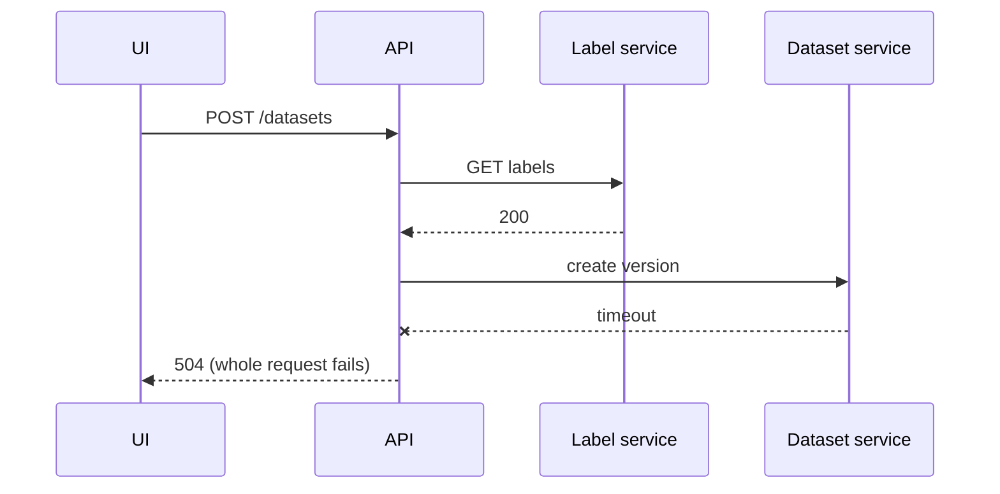
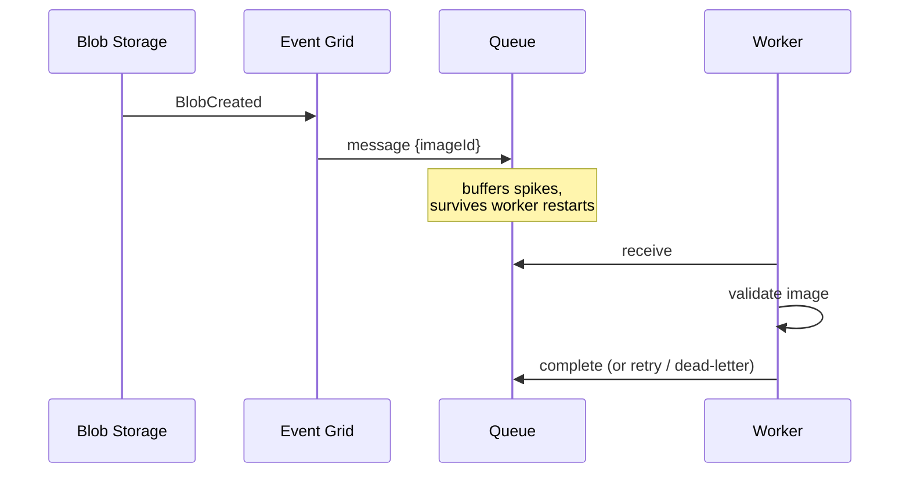

> [!summary] In one line
> **Synchronous:** the caller waits for an answer. **Asynchronous:** the caller hands off work and moves on, and the result arrives later (or never needs to).

## The idea

| | Synchronous | Asynchronous |
| --- | --- | --- |
| Typical tech | HTTP/REST, gRPC | Queues (Service Bus, Storage Queues), events (Event Grid, Kafka) |
| Caller | Blocks until response or timeout | Continues immediately |
| Coupling | **Temporal coupling**: both must be up at the same time | Decoupled in time; a queue buffers |
| Failure | Fails fast and visibly to the caller | Failures surface later; need dead-letter handling |
| Good for | Queries, user-facing reads, quick commands | Long work, spikes, fan-out to many consumers |

## How it works

### Synchronous chain: failures add up

If each service is 99.9% available, a chain of three synchronous calls is roughly 99.7%. Latencies also add up.

### Asynchronous with a queue: buffer and retry

### Async request-reply: for long jobs behind an API

When a user or tool must start something long (train a model, export a dataset) through an HTTP API:

1. `POST /training-jobs` → returns **202 Accepted** with `Location: /training-jobs/123`.
2. Work happens in the background (a queue + Kubeflow pipeline).
3. Client polls `GET /training-jobs/123` → `{"status": "running"}` … `{"status": "succeeded", "modelId": "…"}`.
4. Optionally, a **webhook** notifies when it's done.

This keeps HTTP requests short while the work runs as long as it needs.

## On the platform

- **Image ingestion** fits async: uploads are bursty, validation can lag a little, and nothing should be lost if a worker restarts.
- **Annotation round-trips** to V7 are naturally async: send a batch, get a webhook or poll for completion.
- **Training and batch inference** are async jobs; any API in front of them should use the 202 + status pattern.
- **Dashboards and dataset lookups** are synchronous reads. The user is waiting, and the data is already there.

## Trade-offs

Async gives resilience and absorbs spikes, but costs:

- **Eventual consistency:** the dataset count on the dashboard may lag a few seconds.
- **Duplicate and out-of-order messages:** consumers must be idempotent (see [[09 Idempotency, Retries and Timeouts]]).
- **Harder debugging:** you need correlation IDs and tracing across hops (see [[12 Monitoring, Logging and Tracing]]).
- **Poison messages:** a message that always fails needs a dead-letter queue and someone who watches it.

## Common mistakes

- Long synchronous calls that time out under load ("the export endpoint takes 4 minutes").
- Async everywhere, so a simple read becomes a maze of events.
- No dead-letter queue, or one nobody monitors: data quietly disappears.
- Treating "message sent" as "work done".

## Check yourself

> [!question]- What is temporal coupling?
> Two components must both be running and responsive at the same moment for an operation to succeed, which is typical of synchronous calls.

> [!question]- How should an HTTP API expose a 30-minute training job?
> Async request-reply: return 202 Accepted with a status URL, run the job in the background, and let clients poll or receive a webhook.

> [!question]- What new responsibility does async messaging put on consumers?
> Handling duplicates and retries safely (idempotency), plus dealing with poison messages via dead-lettering.

## Apply it

- [ ] Mark each arrow on the platform diagram as **sync** or **async**. Are there long synchronous calls that should be async?
- [ ] Find out where failed messages go today, and who gets alerted.

## Go deeper

- [Azure: Asynchronous Request-Reply pattern](https://learn.microsoft.com/en-us/azure/architecture/patterns/async-request-reply)
- [Azure: Queue-Based Load Leveling](https://learn.microsoft.com/en-us/azure/architecture/patterns/queue-based-load-leveling)

**Related:** [[06 Message Queues and Pub-Sub]] · [[03 Coupling and Cohesion]] · [[09 Idempotency, Retries and Timeouts]]
