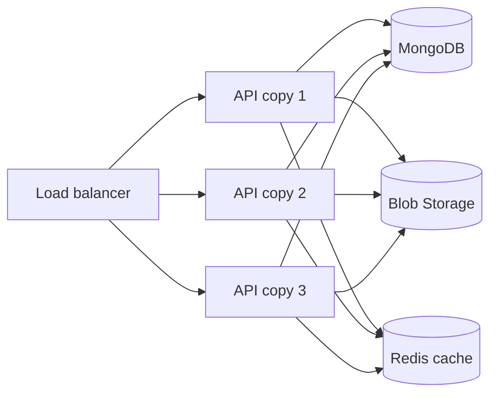

> [!summary] In one line
> A **stateless** service keeps nothing important in its own memory or disk between requests, so any copy can handle any request. A **stateful** service holds data that must survive and be routed to correctly.

## The idea

Every system has state: images, labels, job progress, user sessions. The question is **where** it lives.

- **Stateless service:** state is pushed out to a database, cache, queue or blob store. The service itself is disposable: kill it, start ten more, nothing is lost.
- **Stateful service:** the instance itself holds state (in memory or on local disk), e.g. a database, a cache node, a long training process with in-memory progress, a WebSocket session.

## How it works

The API copies are stateless: the load balancer can send any request anywhere, and autoscaling just adds or removes copies. The **stateful** parts (MongoDB, Blob, Redis) are managed services built to handle replication and durability.

### Making a service stateless

| State | Move it to |
| --- | --- |
| User session | Signed token (JWT) or a shared cache |
| Uploaded file in progress | Blob Storage (upload directly, see [[10 Blob Storage Patterns]]) |
| Job progress | A database record or a pipeline's metadata store |
| In-memory cache | Shared cache (Redis) or accept per-instance cache misses |
| Local temp files | Fine for scratch work *within* one request, but never across requests |

### When stateful is right

- **Databases and caches**, but prefer managed ones.
- **Long-running compute** like training, where restarting is expensive. Make it *recoverable* instead: write **checkpoints** to durable storage so a restarted job continues instead of starting over.
- **Real-time connections** (WebSockets), which need sticky routing or a shared backplane.

## On the platform

- **Azure Functions and FastAPI services** should be stateless. Functions can be recycled at any time, and anything left in memory or `/tmp` may vanish.
- **Kubeflow pipeline steps** run in containers that are created and destroyed. Pass data between steps as **artefacts** in storage, not via a pod's local disk.
- **Training jobs** are stateful by nature, so **checkpointing** to Blob is the reliability feature that matters.
- **Kubernetes** treats stateless workloads as `Deployments` and stateful ones as `StatefulSets` with persistent volumes, which is a clear sign of how different they are to operate.

## Trade-offs

| Stateless | Stateful |
| --- | --- |
| Trivial horizontal scaling and restarts | Scaling needs partitioning or replication |
| Every request may need a round-trip to storage | Fast access to local state |
| Simple deployments, blue-green and canary are easy | Upgrades and failover need care |

## Common mistakes

- Storing uploads or job status in a Function's memory or local disk.
- Sticky sessions used to hide state in the app tier, so scaling and failover break.
- Long jobs without checkpoints: a node eviction at hour 5 costs 5 GPU-hours.

## Check yourself

> [!question]- Why do stateless services scale horizontally so easily?
> Any instance can serve any request, so you scale by adding identical copies behind a load balancer. No data has to move.

> [!question]- A training job is inherently stateful. How do you make it resilient?
> Checkpoint model weights and progress to durable storage regularly, so a restarted job resumes from the last checkpoint.

> [!question]- Why shouldn't a Kubeflow step rely on files written by a previous step to local disk?
> Each step may run in a different pod or node; local disk isn't shared or durable. Use pipeline artefacts in storage.

## Apply it

- [ ] For each component on the platform diagram, mark **stateless**, **stateful (managed)** or **stateful (ours)**. The last group is where operational risk lives.
- [ ] Ask the team: do our long training runs checkpoint, and how often?

## Go deeper

- [The Twelve-Factor App: Processes](https://12factor.net/processes)
- [Kubernetes: StatefulSets](https://kubernetes.io/docs/concepts/workloads/controllers/statefulset/)

**Related:** [[03 Vertical vs Horizontal Scaling]] · [[04 Load Balancing and API Gateways]] · [[05 Caching]]
