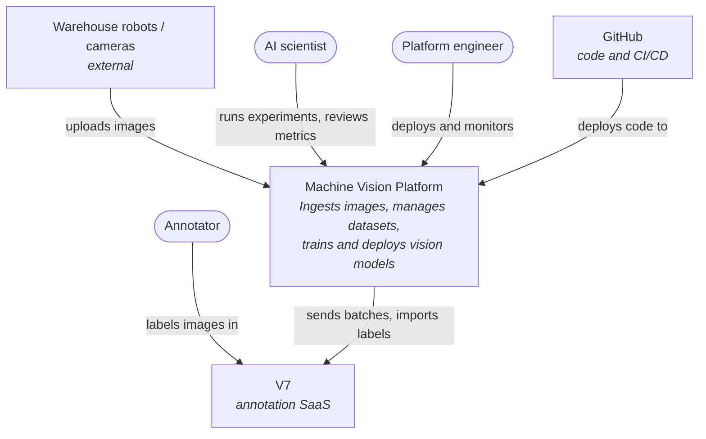
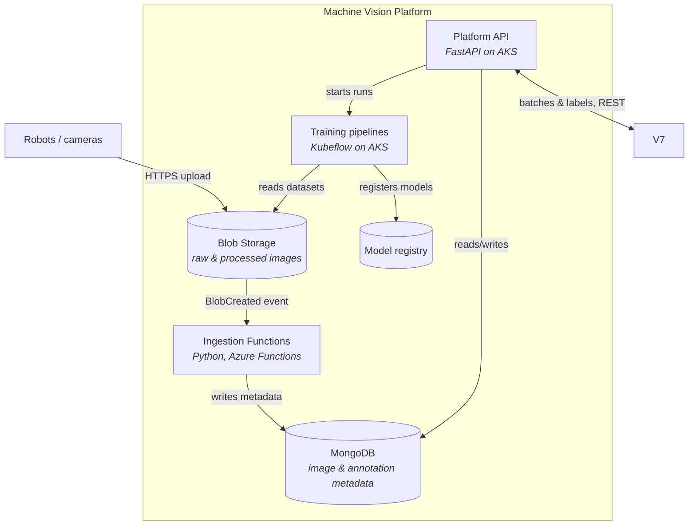

> [!summary] In one line
> The C4 model draws a system at four zoom levels (**Context, Container, Component, Code**) so each audience gets the right level of detail, with boxes and arrows that actually mean something.

## The idea

Most architecture diagrams fail because they mix levels: a box for "Azure", a box for a Python class and a box for "the users", with unlabelled arrows. C4 fixes that with a few rules:

| Level | Shows | Audience |
| --- | --- | --- |
| **1. System context** | Your system as one box, the people who use it, the external systems it talks to | Everyone, including leadership |
| **2. Container** | The deployable/runnable parts: apps, APIs, functions, databases, queues | Architects, tech leads, ops |
| **3. Component** | The main parts inside one container | Developers of that container |
| **4. Code** | Classes, functions | Rarely drawn; let the IDE do it |

> [!note] "Container" in C4 is not a Docker container
> It means *anything that runs or stores data separately*: a FastAPI service, an Azure Function app, a MongoDB database, a Blob container, a SPA. It might happen to run in Docker.

## How it works

### Level 1: System context (example)

### Level 2: Container (example)

> [!warning] These are *example* diagrams
> They're built from the tools named in my roadmap. The month-1 deliverable is to redraw them from **how the platform actually works**, checked with the tech leads.

### The rules that make C4 diagrams useful

1. Every box has a **name, type/technology, and one-line responsibility**.
2. Every arrow has a **label** (what and how: "sends batches, REST/JSON").
3. Arrows go **one direction** and describe intent, not just "talks to".
4. Every diagram has a **title and a key**.
5. One diagram, one level. Don't mix.

## On the platform

- **Context diagram** → for onshore leadership and new joiners: what the platform is, who uses it, what it depends on.
- **Container diagram** → the main tool for architecture discussions and for spotting [[03 Coupling and Cohesion|coupling]], single points of failure and sync/async choices.
- **Component diagrams** → only for complex containers (e.g. the ingestion functions), when a design change is being discussed.

Keep the diagrams **in the repo** as text (Mermaid, Structurizr DSL or PlantUML) so they're versioned and reviewed like code.

## Common mistakes

- One giant diagram with everything.
- Unlabelled arrows, or arrows that go both ways.
- Drawing the ideal future system and calling it current state.
- Diagrams that live in a slide deck and are never updated.

## Check yourself

> [!question]- What are the four C4 levels, and who is each for?
> Context (everyone), Container (technical people across the system), Component (developers of one container), Code (rarely drawn).

> [!question]- What does "container" mean in C4?
> A separately running or deployed thing that executes code or stores data: an app, service, function app, database or storage account. Not necessarily a Docker container.

> [!question]- What three things should every box show?
> Name, technology/type, and its responsibility.

## Apply it

- [ ] **Month-1 deliverable:** draw the real platform's **context** and **container** diagrams in Mermaid, in this vault.
- [ ] Walk one tech lead through it and record every correction they make. Each correction is something I didn't know.

## Go deeper

- [c4model.com](https://c4model.com/): the official guide, short and practical
- [Structurizr](https://structurizr.com/): diagrams as code, C4-native
- [Mermaid C4 syntax](https://mermaid.js.org/syntax/c4.html) (experimental)

**Related:** [[08 Architecture Decision Records]] · [[01 Architecture Styles]] · [[03 Coupling and Cohesion]]
