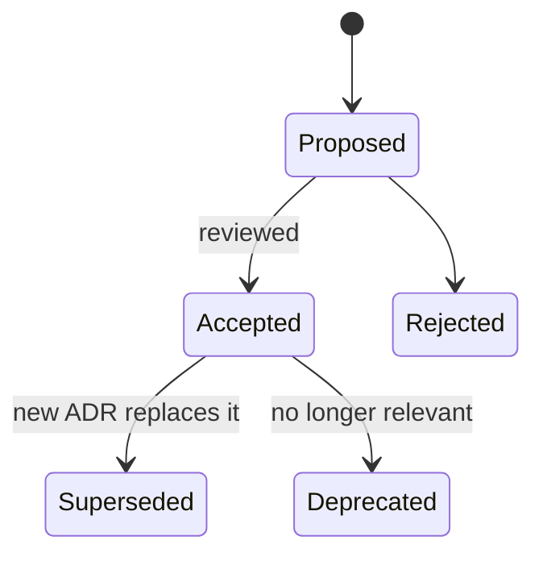

> [!summary] In one line
> An ADR is a one-page note that records **one** significant decision: the context, the options considered, what was chosen and what it costs. It's kept in the repo forever.

## The idea

Six months after a decision, nobody remembers *why* the team chose MongoDB, or why ingestion uses Functions instead of a service. New people re-open the debate, or worse, undo the decision without knowing the constraint behind it.

ADRs fix this cheaply. They're also one of the most visible ways for a manager to **show architectural ownership**: writing the platform's ADRs is explicitly part of the roadmap.

## How it works

### When to write one

Write an ADR when a decision is:

- **Hard to reverse** (database, cloud service, architecture style, API contract), or
- **Cross-cutting** (affects several teams or components), or
- **Contested** (people disagreed, so record why one side won).

Don't write one for library versions or naming conventions.

### A simple template (Michael Nygard style, slightly extended)

```markdown
# ADR-007: Use queue-based ingestion for incoming images

- **Status:** Accepted · 2026-11-20
- **Deciders:** <names>
- **Supersedes / Superseded by:** -

## Context
Robots upload images in bursts of up to N per minute when a new site goes live.
Synchronous validation in the upload API times out under these bursts, and
failed uploads are not retried. [Facts, constraints, forces. No solution yet.]

## Options considered
1. Scale the synchronous upload API
2. Blob upload + Event Grid → Storage Queue → Function worker
3. Blob upload + Event Grid → Service Bus → AKS worker

## Decision
We will use option 2 because ...

## Consequences
- ✅ Bursts are buffered; failed validations retry automatically
- ✅ Upload path no longer depends on validation being up
- ⚠️ Metadata appears with a delay of seconds (eventual consistency)
- ⚠️ We must monitor the poison queue and make the worker idempotent
```

### Rules

1. **One decision per ADR.** Keep it to a page.
2. **Number them** (`ADR-001`, `ADR-002` …) and store them in the repo, e.g. `docs/adr/`.
3. **Never edit an accepted ADR's decision.** If it changes, write a new ADR that *supersedes* it and update the old one's status. The history is the point.
4. **Statuses:** Proposed → Accepted → (Deprecated | Superseded).
5. **Consequences include the bad ones.** An ADR with only upsides isn't honest, and reviewers will notice.



## On the platform

Good first ADRs, **reconstructed from decisions already made**:

- Why MongoDB for annotation metadata (vs relational)
- Why Kubeflow for training pipelines (vs Azure ML pipelines or plain jobs)
- Why event-driven Functions for ingestion
- How datasets are versioned

Writing up past decisions is a low-risk way to start: you learn the reasoning by asking the people who made it, and the team gets documentation it's been missing.

## Common mistakes

- Writing ADRs *after* everyone has forgotten the alternatives.
- Essays. If it's longer than two pages, split it or trim it.
- Hiding them in Confluence where nobody looks. Keep them next to the code.
- Only recording the winner, with no options considered.

## Check yourself

> [!question]- What are the core sections of an ADR?
> Title/number, status, context, decision, consequences. Options considered is a very useful addition.

> [!question]- A decision recorded in ADR-004 has changed. What do you do?
> Write a new ADR (e.g. ADR-012) that explains the new decision and states it supersedes ADR-004. Mark ADR-004 as "Superseded by ADR-012". Don't rewrite ADR-004.

> [!question]- Which decisions deserve an ADR?
> Ones that are hard to reverse, cross-cutting, or contested.

## Apply it

- [ ] Write **ADR-001** for one decision already made on the platform, after interviewing the person who made it.
- [ ] Propose a `docs/adr/` folder and template to the team.

## Go deeper

- [Michael Nygard: Documenting Architecture Decisions](https://cognitect.com/blog/2011/11/15/documenting-architecture-decisions)
- [adr.github.io](https://adr.github.io/): templates (including MADR) and tools
- [Azure Well-Architected: Architecture decision record](https://learn.microsoft.com/en-us/azure/well-architected/architect-role/architecture-decision-record)

**Related:** [[09 Trade-off Analysis]] · [[07 C4 Diagrams]] · [[04 Quality Attributes]]
