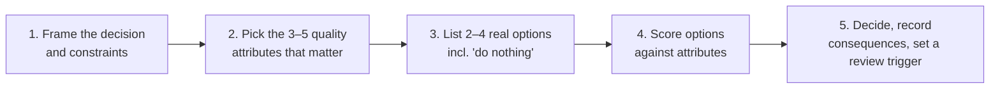

> [!summary] In one line
> There are no best architectures, only trade-offs. Trade-off analysis makes the costs of each option **explicit and comparable**, so the decision can be explained and revisited.

## The idea

"Everything in software architecture is a trade-off" (Richards & Ford). The skill isn't knowing the right answer. It's being able to say:

> "We chose **X** over **Y** because we value **A** more than **B** for this system, and we accept **cost C**. We'll revisit if **D** changes."

That sentence is what onshore leads want to hear in a design review. It's also exactly what goes into an [[08 Architecture Decision Records|ADR]].

## How it works

### A five-step method

1. **Frame it.** What exactly is being decided? What's fixed (budget, team skills, Azure-only, deadline)?
2. **Choose the criteria** from [[04 Quality Attributes]]: only the ones that matter *here*, and agree their weights with stakeholders.
3. **Options:** at least two real ones. Include "keep what we have", because it's often competitive.
4. **Score:** a simple matrix is enough. Back each score with a reason or a quick measurement, not a feeling.
5. **Decide and record.** Write the downsides you're accepting, and the **trigger** that would make you revisit (e.g. "if daily volume exceeds 1M images").

### Example: where to run image validation?

| Criterion (weight) | Azure Functions (event-driven) | FastAPI worker on AKS | Inside Kubeflow pipeline |
| --- | --- | --- | --- |
| Handles bursts (3) | 3, auto-scales per event | 2, needs autoscaler tuning | 1, batch only |
| Ops effort (2) | 3, managed | 2, we run it | 2, we run it |
| Cost at current volume (2) | 3, pay per run | 2, always-on pods | 3, runs only in batch |
| Long/heavy checks e.g. 3D (2) | 1, time and memory limits | 3 | 3 |
| Team familiarity (1) | 3 | 3 | 2 |
| **Weighted total** | **26** | **23** | **21** |

Reading the matrix matters more than the total: Functions win **today**, but the "long/heavy checks" row is the risk. The ADR's revisit trigger might be: *"When 3D point-cloud validation is added, re-evaluate AKS workers."*

> [!tip] The numbers are a conversation tool
> If people disagree with a score, great: that's the real discussion. Weights make value differences visible ("you care about cost, I care about bursts").

### Other useful lenses

- **Reversibility:** "one-way door" vs "two-way door" decisions. Spend analysis time on the one-way doors; decide two-way doors quickly.
- **Cost of delay:** sometimes the best option is the one you can ship this month.
- **Sensitivity:** which single assumption, if wrong, would flip the decision? Validate that one first, maybe with a spike.

## On the platform

Typical trade-offs I'll need to defend (from the roadmap):

- Event-driven Azure Functions **vs** long-running jobs
- MongoDB schema: embed annotations in image documents **vs** separate collection
- Kubeflow pipeline granularity: many small steps **vs** a few big ones
- 3D data: hot vs cool vs archive storage tiers, and format/compression

## Common mistakes

- Comparing one option you like against straw men.
- Criteria chosen *after* the preferred answer is known.
- Ignoring team skills and operational cost.
- No revisit trigger, so a good decision quietly becomes a bad one as conditions change.

## Check yourself

> [!question]- What should a well-stated trade-off decision include?
> The choice, the alternative, the qualities you prioritised, the cost you accept, and when you'd revisit.

> [!question]- What's a one-way door decision? Give a platform example.
> A decision that's expensive or impossible to reverse, e.g. the primary metadata database or the dataset versioning scheme. These deserve careful analysis and an ADR.

> [!question]- Why include "do nothing" as an option?
> It sets the baseline. Sometimes the current system plus small fixes beats a big change once costs and risk are counted.

## Apply it

- [ ] Take one real, current design question from the team and run the five steps, then turn it into an ADR draft.
- [ ] In the next design review, ask "what are we giving up?" for each proposal.

## Go deeper

- *Fundamentals of Software Architecture* (Richards & Ford): trade-offs throughout
- [Azure Well-Architected: Trade-offs per pillar](https://learn.microsoft.com/en-us/azure/well-architected/)
- Jeff Bezos, 2015 Amazon shareholder letter: the original "one-way vs two-way door" framing

**Related:** [[08 Architecture Decision Records]] · [[04 Quality Attributes]] · [[01 Architecture Styles]]
