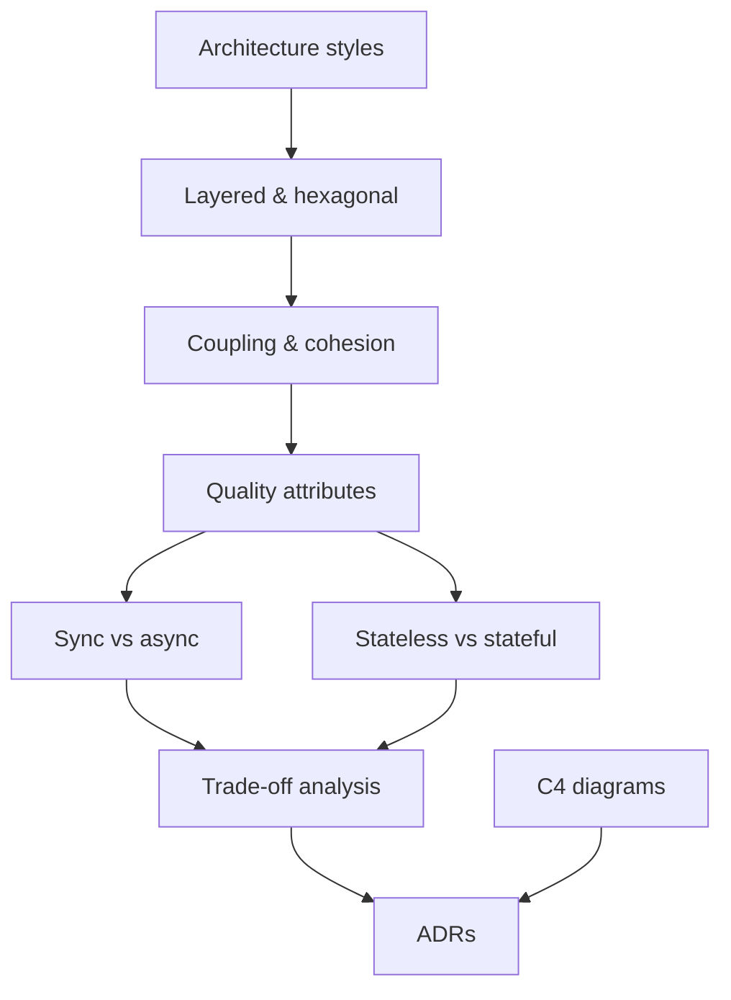

> [!abstract] Why this section
> The aim is to be **architecture-fluent, not architecture-expert**: to whiteboard the whole platform end to end, review designs, and defend trade-offs in front of onshore leads. These nine chapters give me the vocabulary and the habits for that.

## Chapters (in learning order)

- [ ] [[01 Architecture Styles]]: monolith, modular monolith, microservices, event-driven, serverless
- [ ] [[02 Layered and Hexagonal Architecture]]: how to organise code inside a service
- [ ] [[03 Coupling and Cohesion]]: separation of concerns, and why boundaries matter
- [ ] [[04 Quality Attributes]]: scalability, reliability, maintainability, security, cost
- [ ] [[05 Sync vs Async Communication]]: request/response versus messages and events
- [ ] [[06 Stateless vs Stateful Services]]: where state lives and why it matters for scaling
- [ ] [[07 C4 Diagrams]]: context, container and component views
- [ ] [[08 Architecture Decision Records]]: writing decisions down
- [ ] [[09 Trade-off Analysis]]: comparing options honestly

## How the chapters connect

Quality attributes are the centre: every style, boundary and communication choice is a way of buying some qualities at the cost of others. ADRs and C4 diagrams are how I **communicate** those choices.

## Main resources this month

- [Azure Architecture Center](https://learn.microsoft.com/en-us/azure/architecture/): especially *Architecture styles* and *Cloud design patterns*
- *Designing Data-Intensive Applications* (Kleppmann), Chapter 1: reliability, scalability, maintainability
- [c4model.com](https://c4model.com/) for diagrams

## Month-end output

A **C4 context and container diagram** of the real platform, and **one ADR** for a decision that has already been made (writing up a past decision is the easiest first ADR).
