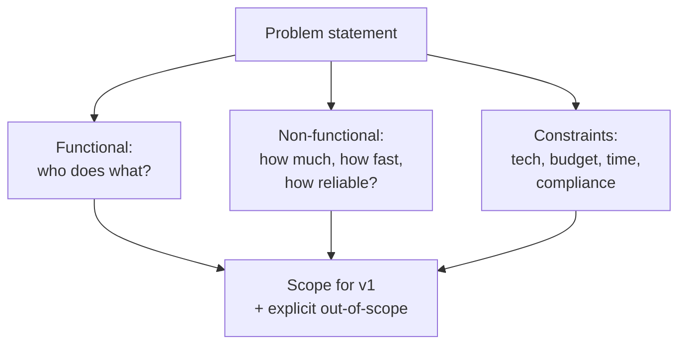

> [!summary] In one line
> **Functional requirements** describe behaviour ("import labels from V7"). **Non-functional requirements** (NFRs) describe qualities and constraints ("import 10,000 labels in under 2 minutes, with no data loss"). Architecture is driven mostly by the second kind.

## The idea

| | Functional | Non-functional |
| --- | --- | --- |
| Answers | What does it do? | How well, under what limits? |
| Example | Users can search images by site and date | Search returns in < 500 ms p95 for 50M images |
| Verified by | Feature tests, acceptance criteria | Load tests, chaos tests, monitoring, audits |
| Changes architecture? | Sometimes | Almost always |

NFR categories map to [[04 Quality Attributes]]: performance, scalability, availability, reliability/durability, security, maintainability, cost, compliance, observability.

**Constraints** are a third kind worth listing separately: things you can't choose ("must run on Azure", "data stays in the EU", "team of six", "go-live by March").

## How it works

### Start every design by clarifying both

### Make NFRs measurable

Weak → strong:

| Weak | Strong |
| --- | --- |
| "Fast" | "Upload accepted in < 2 s p95 for files up to 20 MB" |
| "Highly available" | "Ingestion API 99.9% monthly availability (≈ 43 min downtime)" |
| "Scalable" | "Handles 5× current daily volume without redesign" |
| "Secure" | "Only managed identities access Blob; no secrets in code; images encrypted at rest" |
| "Cheap" | "Storage cost < €X per TB per month after 90 days" |

Useful words: **p50/p95/p99 latency**, **throughput**, **RPO** (how much data can you afford to lose) and **RTO** (how long can you be down), **SLO** (internal target) vs **SLA** (contractual promise).

### Availability cheat sheet

| Availability | Downtime per month |
| --- | --- |
| 99% | ~7.3 hours |
| 99.9% | ~43.8 minutes |
| 99.99% | ~4.4 minutes |

Every extra nine roughly multiplies cost and complexity. Ask: *what does an hour of downtime actually cost?*

## On the platform

Example requirement set for an **image ingestion** capability:

**Functional**
- Robots/cameras upload images with site, robot ID and timestamp metadata.
- Each image is validated (format, resolution, not corrupt, not duplicate).
- Valid images are searchable by site, date and robot.
- Invalid images are quarantined with a reason.

**Non-functional**
- Peak 300 images/min per site during commissioning; 20 sites.
- Zero silent data loss (**durability** over latency).
- Validation result available within 60 s of upload (p95).
- Raw images retained 2 years; moved to cool tier after 30 days.
- Ingestion availability 99.5% (uploads can retry on the robot side).

**Constraints:** Azure, Python, existing MongoDB, data residency in the EU.

> [!note] These numbers are placeholders
> The exercise is to replace them with real figures from the team. Getting real numbers is often the most useful outcome of the exercise.

## Common mistakes

- Jumping to a solution ("we need Kafka") before agreeing on volumes and latency.
- NFRs that nobody measures after go-live.
- Gold-plating: designing for 99.99% when 99.5% is fine.
- Forgetting **operational** requirements: backups, monitoring, on-call, cost reporting.

## Check yourself

> [!question]- Give one functional and one non-functional requirement for model deployment.
> Functional: "A registered model can be promoted to production with one approval." Non-functional: "Promotion completes within 10 minutes and can be rolled back within 5."

> [!question]- What are RPO and RTO?
> RPO (Recovery Point Objective): the maximum acceptable data loss, measured in time. RTO (Recovery Time Objective): the maximum acceptable time to restore service.

> [!question]- What's the difference between an SLO and an SLA?
> An SLO is an internal reliability target. An SLA is a promise to a customer, usually with penalties. SLOs should be stricter than SLAs.

## Apply it

- [ ] Write functional + non-functional requirements for **one** platform capability (ingestion is the easiest). Get real numbers from the team.
- [ ] Turn three of the NFRs into draft **platform KPIs** (month-1 deliverable).

## Go deeper

- [Google SRE Book: Service Level Objectives](https://sre.google/sre-book/service-level-objectives/)
- [Azure Well-Architected: Reliability pillar](https://learn.microsoft.com/en-us/azure/well-architected/reliability/)

**Related:** [[02 Back-of-Envelope Estimation]] · [[04 Quality Attributes]] · [[09 Trade-off Analysis]]
