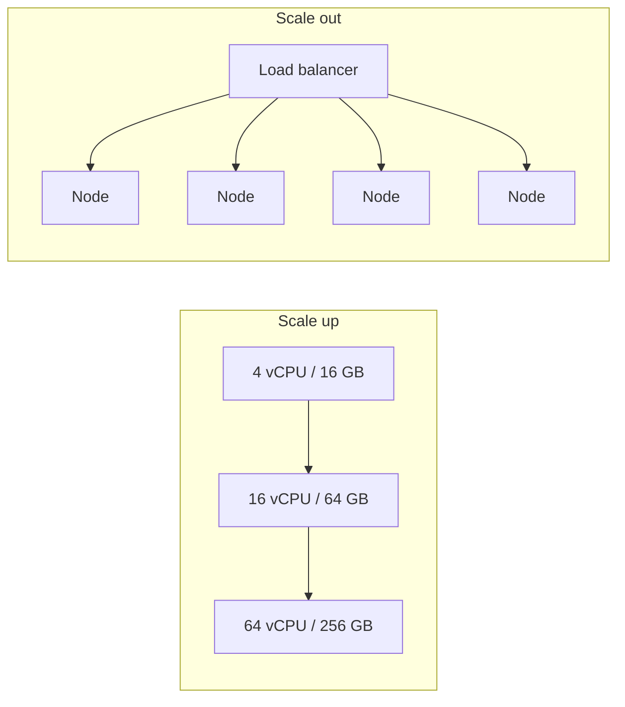

> [!summary] In one line
> **Vertical scaling** (scale up) makes one machine bigger. **Horizontal scaling** (scale out) adds more machines. Scale-up is simpler; scale-out has no ceiling but needs the design to support it.

## The idea

| | Vertical | Horizontal |
| --- | --- | --- |
| How | Bigger VM / node SKU, more RAM, bigger GPU | More instances behind a load balancer or queue |
| Code changes | Usually none | Service must be [[06 Stateless vs Stateful Services\|stateless]], or data must be [[07 Replication, Partitioning and Sharding\|partitioned]] |
| Limit | The biggest machine available, and price grows faster than size | Practically unlimited |
| Failure | One machine = single point of failure | Lose one node, others carry on |
| Downtime to scale | Often a restart | None, if done right |

## How it works

### What scales out easily, and what doesn't

- **Easy:** stateless APIs, Azure Functions, queue workers, batch inference. Add copies.
- **Harder:** databases (need replicas for reads, sharding for writes), anything holding sessions or in-memory state, singletons like schedulers.
- **Special:** GPU training scales out via **data-parallel / distributed training**, which needs framework support (e.g. PyTorch DDP) and fast networking between GPUs, so it's not free.

### Autoscaling

Horizontal scaling becomes powerful when it's automatic:

| Platform | Scales on |
| --- | --- |
| Azure Functions (Consumption/Flex) | Event volume, automatically |
| AKS **Horizontal Pod Autoscaler** | CPU, memory or custom metrics |
| **KEDA** on AKS | Queue length, Blob events, Kafka lag, and more. Ideal for workers |
| AKS **Cluster Autoscaler** / node pools | Adds VMs when pods can't be scheduled, incl. GPU pools that scale to zero |

**Queue-driven scaling** is usually the best signal for workers: "if more than 1,000 messages are waiting, add pods".

### Amdahl's law, informally

If 20% of a job is sequential (can't be parallelised), adding infinite workers can only make it ~5× faster. Find the serial bottleneck before buying more nodes.

## On the platform

- **Ingestion and validation:** scale out (Functions or KEDA-driven workers).
- **MongoDB:** scale up first (bigger tier), add read replicas for dashboards, consider sharding only when [[02 Back-of-Envelope Estimation|estimates]] say one replica set won't do.
- **Training:** scale up first (bigger GPU, more memory) because it's simpler; scale out with distributed training when single-GPU time is too long. Use a **GPU node pool that scales to zero** so idle GPUs don't burn money.
- **Batch inference** over a big dataset: embarrassingly parallel, so split by shard of images and scale out.

## Trade-offs

- Scale-up first is often right: **simpler, cheaper to operate**, and fine until you hit the ceiling.
- Scale-out brings distributed-systems problems: consistency, partial failure, coordination, more to monitor.
- Autoscaling needs **limits** (max replicas, budget alerts), or a bug or traffic spike becomes a cost incident.

## Common mistakes

- Scaling out a service that's actually blocked on a single database.
- No max replica setting, then a retry storm scales to 200 pods.
- Scaling on CPU for I/O-bound workers. Scale on queue length instead.
- Leaving GPU nodes running overnight.

## Check yourself

> [!question]- What does a service need before it can scale horizontally?
> It must be stateless (or have partitioned state) so any instance can handle any request, plus something to spread load: a load balancer or a shared queue.

> [!question]- Why is queue length a better autoscaling signal than CPU for a validation worker?
> Workers may be I/O-bound (waiting on Blob reads) with low CPU while the backlog grows. Queue length measures the actual work waiting.

> [!question]- When is vertical scaling the better choice?
> When load fits comfortably on a bigger machine, the component is hard to distribute (e.g. a database, single-GPU training), and simplicity matters more than unlimited growth.

## Apply it

- [ ] For each platform component, note: how does it scale today, and what's its scaling limit?
- [ ] Check whether GPU node pools scale to zero, and what idle GPUs cost per month.

## Go deeper

- [KEDA scalers](https://keda.sh/docs/latest/scalers/)
- [Azure: Autoscaling best practices](https://learn.microsoft.com/en-us/azure/architecture/best-practices/auto-scaling)
- *Designing Data-Intensive Applications*, Ch. 1 (describing load and performance)

**Related:** [[04 Load Balancing and API Gateways]] · [[06 Stateless vs Stateful Services]] · [[07 Replication, Partitioning and Sharding]]
