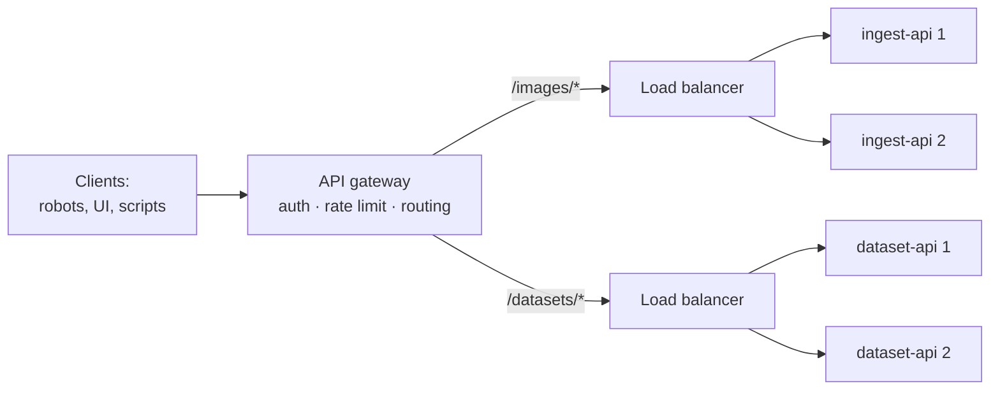

> [!summary] In one line
> A **load balancer** spreads requests across healthy copies of a service. An **API gateway** is a smarter front door that also handles routing, auth, rate limits and versioning for many services.

## The idea

## How it works

### Load balancers

**Layer 4 (transport):** routes TCP/UDP connections by IP and port. Fast, protocol-agnostic. *Azure Load Balancer.*

**Layer 7 (application):** understands HTTP: routes by path, host or header, terminates TLS, can add a WAF. *Azure Application Gateway, Front Door, Kubernetes Ingress (NGINX, Application Gateway for Containers).*

**Common algorithms**

| Algorithm | Behaviour | Good for |
| --- | --- | --- |
| Round robin | Next server in turn | Similar, short requests |
| Least connections | Server with fewest active connections | Requests of uneven length |
| Weighted | More traffic to bigger servers, or to a canary | Canary releases, mixed node sizes |
| Hash (IP / key) | Same client → same server | Session affinity, cache locality |

**Health checks** are the critical feature: the balancer probes `/health` and stops sending traffic to failing instances. Distinguish:
- **Liveness:** "is the process alive?" Restart it if not.
- **Readiness:** "can it serve traffic right now?" (DB reachable, model loaded). Remove from rotation if not.

### API gateways

A gateway adds **cross-cutting concerns** in one place, so each service doesn't reimplement them:

- Authentication (validate JWT / API keys), sometimes authorisation
- [[11 Rate Limiting|Rate limiting]] and quotas per client
- Routing and **API versioning** (`/v1`, `/v2`)
- Request/response transformation, CORS
- Caching of responses
- Central logging, metrics and correlation IDs
- A developer portal and API documentation

*Azure API Management (APIM)* is the managed option; Kubernetes ingress controllers cover part of this.

**Backend for Frontend (BFF):** a variant where each client type (web UI, robots, internal scripts) gets its own small gateway shaped for its needs.

## On the platform

- **Robots uploading images** → don't push big files through the gateway; use a SAS URL and direct-to-Blob upload ([[10 Blob Storage Patterns]]). The gateway only handles the small "give me an upload URL" call.
- **FastAPI services on AKS** → an ingress controller load-balances across pods; readiness probes should check that dependencies (MongoDB, model files) are ready.
- **Model serving** → a weighted route sends 5% of traffic to a new model version (**canary**), then increases.
- **Gateway** (e.g. APIM) → useful once several teams or external partners consume platform APIs; overkill for one internal service.

## Trade-offs

| Benefit | Cost |
| --- | --- |
| One place for auth, limits, logs | Another hop of latency, another thing to run |
| Hides internal topology | Can become a bottleneck or single point of failure (run it redundantly) |
| Consistent versioning | Risk of business logic creeping into the gateway |

## Common mistakes

- Health checks that always return 200, so the balancer keeps sending traffic to broken pods.
- Readiness probes that check *every* downstream dependency, so one slow dependency takes everything out of rotation.
- Business logic in gateway policies, where it's hard to test.
- Sticky sessions used to hide in-memory state (see [[06 Stateless vs Stateful Services]]).

## Check yourself

> [!question]- What's the difference between L4 and L7 load balancing?
> L4 routes connections by IP/port without understanding the content. L7 understands HTTP and can route by path, host or headers, terminate TLS and apply WAF rules.

> [!question]- Liveness vs readiness probe?
> Liveness: is the process healthy, or should it be restarted? Readiness: is it ready to receive traffic right now? A pod can be live but not ready, e.g. while loading a model.

> [!question]- Name four things an API gateway typically handles.
> Authentication, rate limiting, routing/versioning, and centralised logging/metrics (also caching, CORS, transformations).

## Apply it

- [ ] Find out what sits in front of the platform's APIs today (ingress, App Gateway, APIM, nothing?).
- [ ] Check one service's `/health` endpoint: does it separate liveness and readiness?

## Go deeper

- [Azure: Load-balancing options](https://learn.microsoft.com/en-us/azure/architecture/guide/technology-choices/load-balancing-overview)
- [Azure: Gateway Routing pattern](https://learn.microsoft.com/en-us/azure/architecture/patterns/gateway-routing)
- [Azure: Backends for Frontends pattern](https://learn.microsoft.com/en-us/azure/architecture/patterns/backends-for-frontends)

**Related:** [[03 Vertical vs Horizontal Scaling]] · [[11 Rate Limiting]] · [[12 Monitoring, Logging and Tracing]]
