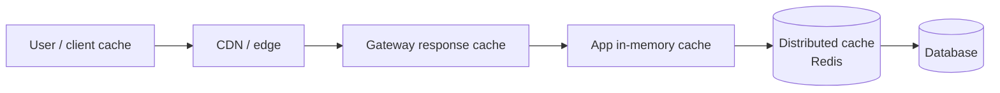
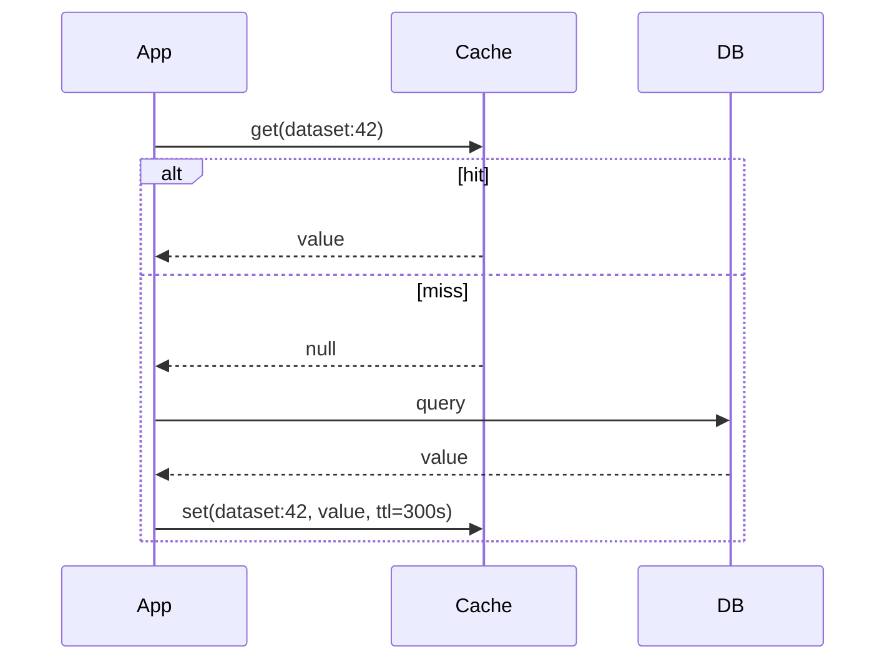

> [!summary] In one line
> A cache stores the result of expensive work so the next request is cheap. The benefit is speed and lower load; the price is **stale data** and the problem of knowing when to throw copies away.

## The idea

Caches exist at every level:

Cache when data is **read often, changes rarely, and is expensive** to compute or fetch. Measure with the **hit ratio**: hits ÷ total lookups.

## How it works

### Read strategies

**Cache-aside (lazy loading)**: the most common:

**Read-through:** the cache library itself loads from the DB on a miss. Same idea, less app code.

### Write strategies

| Strategy | How | Trade-off |
| --- | --- | --- |
| **Write-through** | Write to cache and DB together | Cache always fresh; writes slower |
| **Write-around** | Write to DB only; cache fills on next read | Good when written data isn't read soon |
| **Write-behind (write-back)** | Write to cache, flush to DB later | Fast writes; **risk of data loss**. Rarely right for important data |

### Invalidation

> "There are only two hard things in Computer Science: cache invalidation and naming things." (Phil Karlton)

Options, from simplest:

1. **TTL (time to live):** entries expire after N seconds. Simple; accept staleness up to N.
2. **Explicit delete on write:** when a dataset changes, delete `dataset:42`. Next read reloads.
3. **Versioned keys:** `dataset:42:v7`. A new version means a new key; old ones expire naturally. Great for **immutable** data.
4. **Event-driven invalidation:** publish `DatasetUpdated` events; caches subscribe and evict.

### Eviction

When the cache is full: **LRU** (least recently used) is the usual default; **LFU** (least frequently used) for skewed popularity.

### Cache stampede

A popular key expires → hundreds of requests miss at once → all hit the DB. Fixes: a lock so only one request recomputes, slight random **jitter** on TTLs, or refresh-ahead before expiry.

## On the platform

- **Immutable things cache best.** A versioned dataset manifest or a registered model artefact never changes, so cache it forever by version key.
- **Dashboard aggregates** (images per site per day, annotation progress) → cache with a TTL of a few minutes; nobody needs real-time.
- **Thumbnails** → generate once, store in Blob, serve via CDN.
- **Model weights** on inference pods → cache on local disk at startup instead of downloading per request.
- **Don't cache** job status that users are actively polling unless the TTL is very short.

## Trade-offs

- Every cache is a **second copy**, so you've chosen [[08 CAP Theorem and Consistency|eventual consistency]] for that data.
- Another component to run, monitor and secure (Azure Cache for Redis).
- Caches can hide performance problems until they go cold (after a deploy or restart).

## Common mistakes

- Caching without a TTL or invalidation plan.
- Caching per-user or permission-sensitive data under a shared key, which leaks data across users.
- In-memory caches on many pods, each with different stale values.
- Treating the cache as the source of truth.

## Check yourself

> [!question]- Describe cache-aside in three steps.
> Read from cache; on a miss, read from the database; write the result into the cache with a TTL and return it.

> [!question]- Why are versioned or immutable keys the easiest to cache?
> The value under a key never changes, so there's nothing to invalidate. New data gets a new key.

> [!question]- What is a cache stampede and one way to prevent it?
> Many requests miss the same expired key at once and overload the database. Prevent with a recompute lock, TTL jitter or refresh-ahead.

## Apply it

- [ ] Identify the slowest frequent read on the platform (often a dashboard or dataset query). Would a 5-minute TTL be acceptable to its users?
- [ ] Check whether dataset versions and model artefacts are immutable. If yes, they're free wins for caching.

## Go deeper

- [Azure: Cache-Aside pattern](https://learn.microsoft.com/en-us/azure/architecture/patterns/cache-aside)
- [Azure: Caching guidance](https://learn.microsoft.com/en-us/azure/architecture/best-practices/caching)

**Related:** [[08 CAP Theorem and Consistency]] · [[10 Blob Storage Patterns]] · [[06 Stateless vs Stateful Services]]
