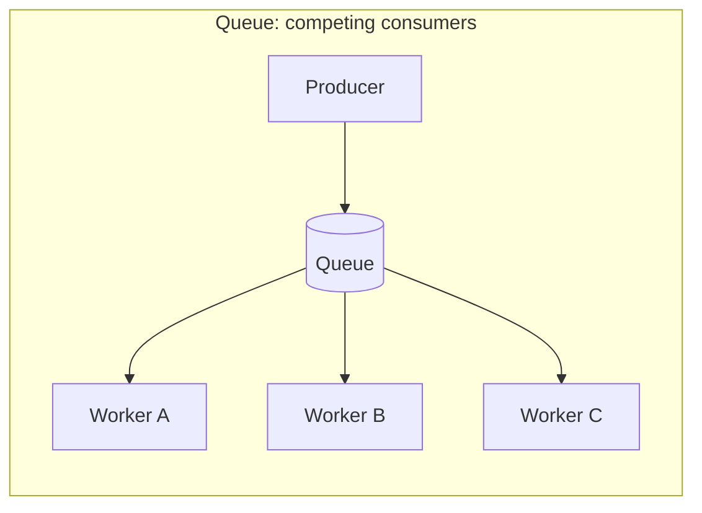
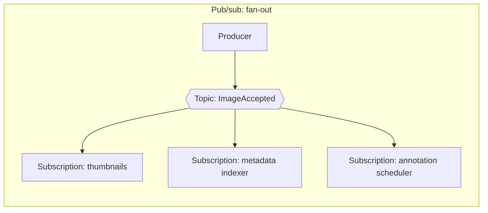
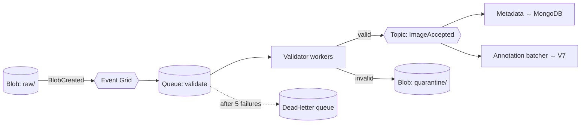

> [!summary] In one line
> A **queue** hands each message to **one** consumer (a work list). **Pub/sub** gives each message to **every** subscriber (a broadcast). Both decouple producers from consumers in time and load.

## The idea

*Each message is processed by exactly one worker. Add workers to go faster.*

*Each subscriber gets its own copy. Add new subscribers without touching the producer.*

## How it works

### Why use them

- **Load levelling:** a burst of 50,000 uploads becomes a backlog that workers drain at a steady rate.
- **Resilience:** if workers are down, messages wait instead of being lost.
- **Decoupling:** the producer doesn't know or care who consumes ([[03 Coupling and Cohesion]]).
- **Fan-out:** one fact, many reactions.

### Commands vs events

| | Command | Event |
| --- | --- | --- |
| Meaning | "Please do X" | "X happened" |
| Example | `ValidateImage {id}` | `ImageAccepted {id, site}` |
| Usually on | A queue (one handler) | A topic (many subscribers) |
| Naming | Imperative | Past tense |

### Delivery guarantees

| Guarantee | Meaning | Reality |
| --- | --- | --- |
| At-most-once | May be lost, never duplicated | Rarely acceptable for data |
| **At-least-once** | Never lost, may be duplicated | **The usual default**, so consumers must be idempotent |
| Exactly-once | Neither lost nor duplicated | Only within specific systems; end-to-end you approximate it with **at-least-once + idempotency** |

How at-least-once works: the consumer **receives** a message (it becomes invisible / locked), processes it, then **completes** it. If the consumer crashes before completing, the lock expires and the message is redelivered. See [[09 Idempotency, Retries and Timeouts]].

### Poison messages and dead-letter queues

A message that fails every time (corrupt file, bad schema) would block or loop forever. After N attempts it's moved to a **dead-letter queue (DLQ)** for inspection. **Someone must own the DLQ**, with an alert when it's non-empty.

### Ordering

Most queues give **best-effort** order. If order matters (e.g. per robot), use **sessions / partition keys** so messages for the same key go in order to one consumer, at the cost of parallelism.

### Azure options

| Service | Best for |
| --- | --- |
| **Storage Queues** | Simple, cheap, high volume work queues |
| **Service Bus** | Business messaging: topics/subscriptions, sessions (ordering), DLQ, duplicate detection, transactions |
| **Event Grid** | Reactive event routing, e.g. Blob `BlobCreated` → handlers. Push-based, lightweight events |
| **Event Hubs** | High-throughput **streams** (telemetry, logs), Kafka-compatible, replayable |

Rule of thumb: *Event Grid* for "something happened" notifications, *Service Bus/Storage Queue* for work to be done, *Event Hubs* for streams of data.

## On the platform

A robust ingestion flow:

- Messages carry **IDs and pointers** (blob path), never the image bytes. This is the *claim-check* pattern, see [[10 Blob Storage Patterns]].
- Include a **correlation ID** and **schema version** in every message.

## Trade-offs

- Eventual consistency and harder debugging (see [[05 Sync vs Async Communication]]).
- Backlogs can hide problems. Monitor **queue length** and **age of oldest message**.
- Schema changes to events affect every subscriber, so version them.

## Common mistakes

- Putting large payloads in messages (size limits, cost).
- No DLQ alert; failures pile up silently.
- Assuming exactly-once and not making handlers idempotent.
- Using pub/sub for a command that must be handled exactly once by one owner.

## Check yourself

> [!question]- Queue vs topic in one sentence each?
> Queue: each message goes to one of many competing consumers. Topic: each message is copied to every subscription.

> [!question]- Why does at-least-once delivery require idempotent consumers?
> A message may be redelivered after a crash or lock timeout, so processing it twice must have the same effect as once.

> [!question]- When would you choose Event Hubs over Service Bus?
> For high-throughput streams that consumers read and may replay (telemetry, logs), rather than discrete business messages that need per-message handling, DLQ and sessions.

## Apply it

- [ ] Draw the real message flow on the platform: which queues and topics exist, who produces, who consumes, where the DLQs are.
- [ ] Check message size: do any messages carry image data instead of a blob reference?

## Go deeper

- [Azure: Competing Consumers pattern](https://learn.microsoft.com/en-us/azure/architecture/patterns/competing-consumers)
- [Azure: Publisher-Subscriber pattern](https://learn.microsoft.com/en-us/azure/architecture/patterns/publisher-subscriber)
- [Azure: Choose between Event Grid, Event Hubs and Service Bus](https://learn.microsoft.com/en-us/azure/service-bus-messaging/compare-messaging-services)

**Related:** [[05 Sync vs Async Communication]] · [[09 Idempotency, Retries and Timeouts]] · [[10 Blob Storage Patterns]]
