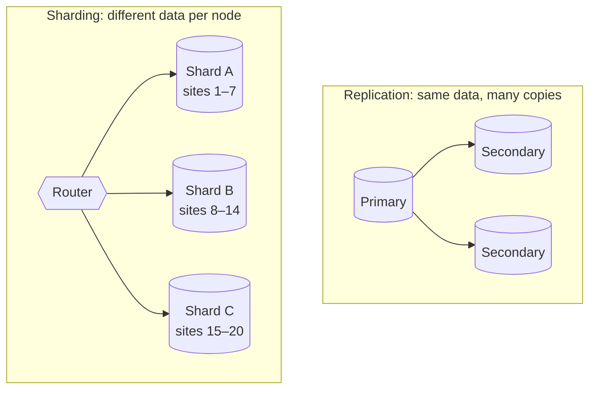

> [!summary] In one line
> **Replication** keeps *copies* of the same data on several nodes (for availability and read scale). **Partitioning / sharding** splits data into *pieces* across nodes (for size and write scale). Real systems use both.

## The idea

"Partitioning" is the general idea; "sharding" usually means partitioning **across machines**. Each shard is often itself a replica set.

## How it works

### Replication

| Model | How | Watch out for |
| --- | --- | --- |
| **Single-leader** (primary/secondary) | All writes go to the primary; secondaries copy its log | **Replication lag**: reads from secondaries can be stale |
| **Multi-leader** | Several nodes accept writes (e.g. per region) | Write conflicts need resolution rules |
| **Leaderless** | Write to/read from a quorum of nodes (Cassandra-style) | Tuning quorum sizes (W + R > N) |

- **Synchronous** replication: the write waits for replicas, so it's safer but slower.
- **Asynchronous**: faster, but a primary crash can lose the last writes.
- **Failover:** if the primary dies, a secondary is elected. Clients must reconnect, and in-flight writes may fail, so [[09 Idempotency, Retries and Timeouts|retries]] matter.

**MongoDB:** a **replica set** is single-leader (one primary, usually two secondaries). **Write concern** (`w: "majority"`) controls durability; **read preference** (`primary`, `secondaryPreferred`) controls where reads go and how stale they may be.

### Partitioning / sharding

The key decision is the **partition (shard) key**:

| Strategy | How | Good | Bad |
| --- | --- | --- | --- |
| **Range** | Key ranges per shard (dates A–M, N–Z) | Efficient range queries | **Hot spots**: e.g. all new writes hit the "today" shard |
| **Hash** | Hash of key decides shard | Even spread of writes | Range queries hit every shard |
| **Directory / lookup** | A table maps keys → shards | Flexible | The lookup is a dependency |
| **Compound** | e.g. `{site, capturedAt}` | Spreads by site, range-friendly within site | Needs knowledge of query patterns |

A good shard key has **high cardinality**, **spreads writes evenly**, and **matches the most common query filter** so queries hit one shard (targeted), not all (scatter-gather).

**Rebalancing:** when you add shards, data moves. It's expensive, so choose keys carefully. Changing a shard key later is painful.

## On the platform

For an image-metadata collection in MongoDB:

- **Start with a replica set** (3 nodes). It gives availability and enough capacity for a long time (see the ~0.85 TB/year estimate in [[02 Back-of-Envelope Estimation]]).
- Point **dashboards and analytics** at secondaries (`secondaryPreferred`) if a few seconds' lag is fine; keep the **ingestion writes and job state** on the primary.
- If sharding becomes necessary: `capturedAt` alone is a bad key (every new write hits one shard). `{siteId: 1, capturedAt: 1}` or a hashed `imageId` spreads writes; choose based on whether most queries filter by site.
- **Blob Storage** is already partitioned for you. But naming still matters for listing and lifecycle rules, see [[10 Blob Storage Patterns]].
- **Partitioning also applies to work:** batch inference over 2M images is "sharded" by splitting the image list across workers.

## Trade-offs

- Replicas add availability and read capacity, but bring **stale reads** and failover complexity.
- Sharding adds write and storage capacity, but brings cross-shard queries, harder transactions and operational complexity.
- **Don't shard early.** Indexes, a bigger tier and archiving old data often go much further.

## Common mistakes

- Reading from secondaries for "read your own write" flows (user saves, then sees old data).
- Monotonically increasing shard keys (timestamps, ObjectIds) on range sharding, so all writes go to one hot shard.
- Sharding to fix slow queries that just needed an index.

## Check yourself

> [!question]- What problem does replication solve, and what problem does sharding solve?
> Replication: availability and read scaling (copies). Sharding: data size and write scaling (splitting).

> [!question]- Why is a timestamp a bad range shard key for new images?
> All new writes have the latest timestamps, so they all land on the same shard, creating a hot spot.

> [!question]- What is replication lag and when does it hurt?
> The delay before a secondary reflects a write on the primary. It hurts when a client writes and then reads from a secondary, and doesn't see its own change.

## Apply it

- [ ] Find out the platform's MongoDB topology (replica set? sharded? Atlas tier?) and the read preference used by dashboards.
- [ ] Run `explain()` on the most common image query. Does it use an index? (December/January will go deeper on MongoDB.)

## Go deeper

- *Designing Data-Intensive Applications*, Ch. 5 (Replication) and Ch. 6 (Partitioning)
- [MongoDB: Replication](https://www.mongodb.com/docs/manual/replication/) · [Sharding](https://www.mongodb.com/docs/manual/sharding/)
- [Azure: Sharding pattern](https://learn.microsoft.com/en-us/azure/architecture/patterns/sharding)

**Related:** [[08 CAP Theorem and Consistency]] · [[03 Vertical vs Horizontal Scaling]] · [[02 Back-of-Envelope Estimation]]
