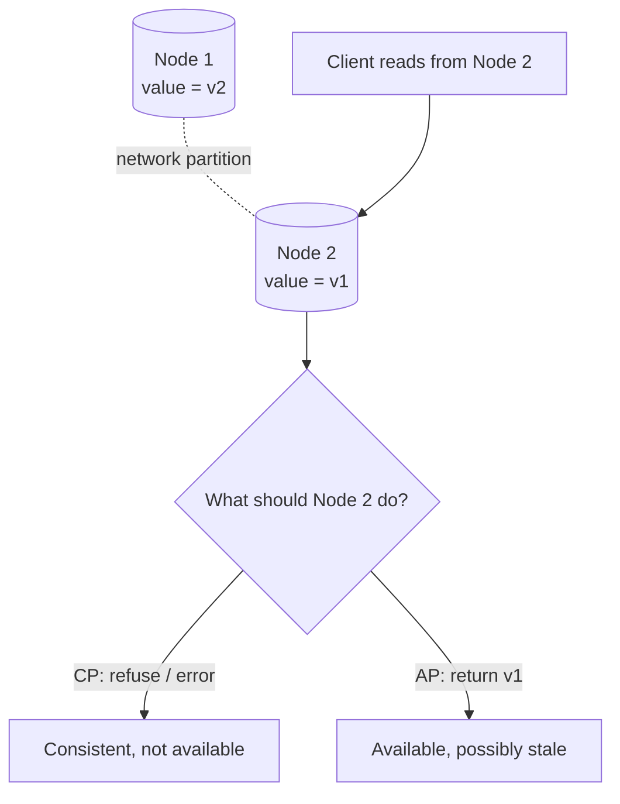

> [!summary] In one line
> When a network partition splits a distributed system, it must choose between staying **consistent** (refuse some requests) and staying **available** (answer, possibly with stale data). Day to day, the real trade-off is **consistency vs latency**.

## The idea

**CAP** says a distributed data system can't guarantee all three at once *during a network partition*:

- **C**onsistency (linearisability): every read sees the latest write.
- **A**vailability: every request to a non-failed node gets a response.
- **P**artition tolerance: the system keeps working despite lost messages between nodes.

Partitions *will* happen in any distributed system, so P isn't optional. The real choice is: **when partitioned, C or A?**

### PACELC: the more useful version

> If **P**artition → choose **A** or **C**; **E**lse (normal operation) → choose **L**atency or **C**onsistency.

Most of the time there's no partition, but waiting for replicas to confirm every write still costs latency. That's the trade-off you tune daily.

## How it works

### Consistency models (strong → weak)

| Model | Guarantee | Example use |
| --- | --- | --- |
| **Strong / linearisable** | Reads always see the latest committed write | Job state transitions, model promotion, payments |
| **Sequential / causal** | Operations seen in an order that respects cause → effect | Comments and replies, label edits then review |
| **Read-your-writes** | *You* always see your own writes | User edits a dataset name and sees it immediately |
| **Monotonic reads** | You never see data go "back in time" | Dashboards that don't flicker between old and new |
| **Eventual** | If writes stop, all replicas converge… eventually | Counters, analytics, search indexes, caches |

### Where you choose it in practice

- **MongoDB:** `writeConcern: majority` + `readConcern: majority` + read from primary → strong-ish; `readPreference: secondary` → eventual. Causal consistency is available via **sessions**.
- **Caches and read replicas** → eventual by design (see [[05 Caching]], [[07 Replication, Partitioning and Sharding]]).
- **Events between services** → the other service's view is eventually consistent (see [[06 Message Queues and Pub-Sub]]).
- **Azure Cosmos DB** famously offers five selectable levels: strong, bounded staleness, session, consistent prefix, eventual.

### ACID vs BASE (quick contrast)

- **ACID** (relational transactions): Atomic, Consistent, Isolated, Durable.
- **BASE**: Basically Available, Soft state, Eventually consistent, typical of large distributed stores.

Note: the "C" in ACID (data satisfies invariants) is **not** the same "C" as in CAP (linearisability).

## On the platform

Decide **per piece of data**, not per system:

| Data | Needs | Why |
| --- | --- | --- |
| Training job state, model promotion to production | **Strong** | Two people must not promote different models at once; a job must not run twice |
| Dataset version manifest | **Strong on write**, then immutable | Lineage must be exact; once written it never changes, so reads can be cached |
| Annotation progress counters | **Eventual** | A few seconds' lag is fine |
| Dashboards, search, thumbnails | **Eventual** | Speed matters more than freshness |
| User's own edits in the UI | **Read-your-writes** | Otherwise users think saving failed |

## Common mistakes

- Saying "we picked CA". In a distributed system you can't opt out of partitions.
- Using eventual consistency for things that need a single source of truth (job ownership, locks).
- Demanding strong consistency everywhere and paying for it in latency and availability.
- Not telling users that data is eventually consistent, so they file bugs about "missing" images that appear 10 s later.

## Check yourself

> [!question]- State CAP in one sentence.
> During a network partition, a distributed system must choose between consistency (every read sees the latest write) and availability (every request gets a response).

> [!question]- What does PACELC add?
> Even without partitions, there's a trade-off between latency and consistency.

> [!question]- Which platform data needs strong consistency, and which can be eventual?
> Strong: job state, model promotion, dataset version creation. Eventual: dashboards, counters, search indexes, caches.

## Apply it

- [ ] For the five most important data items on the platform, write down the consistency each needs, then check what the code actually uses (read preference, write concern, caches).

## Go deeper

- *Designing Data-Intensive Applications*, Ch. 9 (Consistency and Consensus)
- [Martin Kleppmann: Please stop calling databases CP or AP](https://martin.kleppmann.com/2015/05/11/please-stop-calling-databases-cp-or-ap.html)
- [MongoDB: Read concern](https://www.mongodb.com/docs/manual/reference/read-concern/) · [Write concern](https://www.mongodb.com/docs/manual/reference/write-concern/)

**Related:** [[07 Replication, Partitioning and Sharding]] · [[05 Caching]] · [[06 Message Queues and Pub-Sub]]
