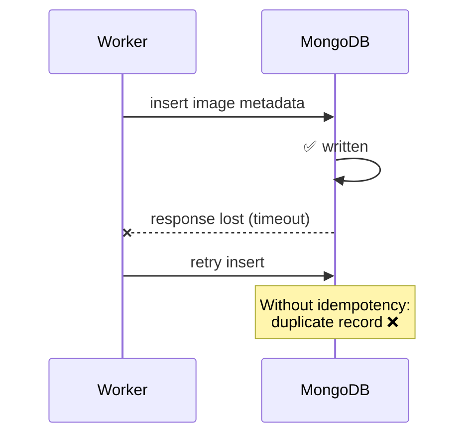
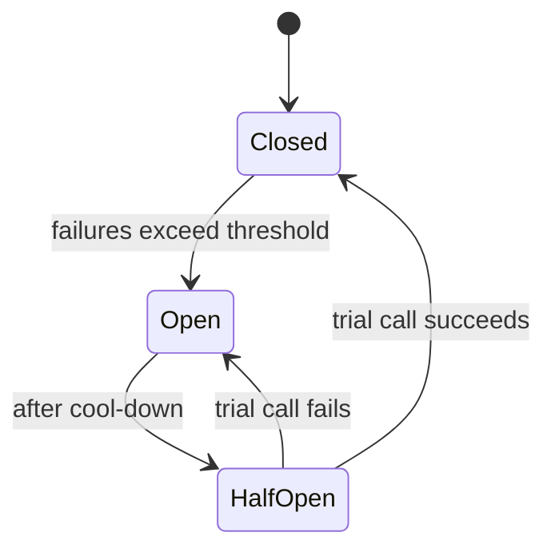

> [!summary] In one line
> Every remote call needs a **timeout**; failed calls are **retried** with backoff; and because retries cause duplicates, operations must be **idempotent**, so doing them twice has the same effect as doing them once.

## The idea

In a distributed system, when a call fails you often **don't know whether it happened**. The request may have failed, or it succeeded and the response got lost.



The three tools work together:

1. **Timeouts:** don't wait forever.
2. **Retries:** try again for transient failures.
3. **Idempotency:** make the retry safe.

## How it works

### Timeouts

- Set a timeout on **every** network call: HTTP, DB, Blob, queue. Library defaults are often infinite or very long.
- Set them from **observed latency** (e.g. a bit above p99), not guesses.
- **Budget across a chain:** if the user-facing request has 5 s, the downstream calls can't each have 5 s.

### Retries

Retry only **transient** errors: timeouts, 429 Too Many Requests, 503, connection resets. Don't retry 400 Bad Request or 404.

**Exponential backoff with jitter:**

```text
attempt 1 → wait ~0.5s
attempt 2 → wait ~1s
attempt 3 → wait ~2s
attempt 4 → wait ~4s   (+ random jitter each time)
give up → dead-letter / alert
```

Jitter stops thousands of clients retrying at the same instant (a **retry storm** / thundering herd). Respect `Retry-After` headers.

```python
# Python: tenacity makes this one decorator
from tenacity import retry, stop_after_attempt, wait_random_exponential, retry_if_exception_type

@retry(stop=stop_after_attempt(5),
       wait=wait_random_exponential(multiplier=0.5, max=10),
       retry=retry_if_exception_type((TimeoutError, ConnectionError)))
def fetch_labels(batch_id: str) -> dict: ...
```

> [!warning] Retry at one layer only
> If the SDK retries 3×, your code retries 3× and the queue redelivers 3×, one failure becomes **27 attempts**. Know which layer owns retries.

### Circuit breaker

If a dependency is clearly down, stop hammering it:



**Open** = fail fast immediately, so the dependency gets room to recover.

### Idempotency techniques

| Technique | How | Example |
| --- | --- | --- |
| **Natural idempotency** | Operation is inherently repeatable | `PUT /datasets/42 {name}`; "set status = done" |
| **Idempotency key** | Client sends a unique key; server stores the result per key and returns it on repeat | `POST /training-jobs` with `Idempotency-Key: 7f3c…` |
| **Unique constraint / upsert** | Deterministic ID + unique index; repeat insert becomes no-op or update | `imageId = sha256(content)` as `_id`; `update_one(..., upsert=True)` |
| **Dedup table** | Record processed message IDs; skip if seen | Queue consumer stores `messageId` with TTL |
| **Conditional writes** | Only apply if version/state matches | "Set status=running **if** status=queued"; Blob ETag `If-Match` |

HTTP semantics: `GET`, `PUT`, `DELETE` should be idempotent; `POST` isn't, unless you add an idempotency key.

## On the platform

- **Image IDs from content hashes** → re-uploading or reprocessing the same image never creates a duplicate record, and it doubles as duplicate detection.
- **Queue consumers** (validation, metadata) → upsert by image ID; treat redelivery as normal.
- **Starting training jobs** → idempotency key per request, plus a conditional state transition (`queued → running` only once), so a double-click or retry doesn't launch two GPU jobs.
- **V7 API calls** → retry 429/5xx with backoff, respect rate limits ([[11 Rate Limiting]]), circuit-break if V7 is down so the backlog waits in a queue.
- **Kubeflow steps** → design each step to be **re-runnable**: write outputs to a deterministic path and overwrite or skip if already present.

## Common mistakes

- No timeout on outbound HTTP calls, so threads hang and the service stalls.
- Retrying non-idempotent `POST`s, creating duplicate jobs or records.
- Immediate retries with no backoff, which amplify an outage.
- Using random UUIDs generated *on each attempt* as idempotency keys; the key must be stable across retries.

## Check yourself

> [!question]- Why can't you tell whether a timed-out request succeeded?
> The request may have been processed and only the response lost. From the caller's side, both cases look identical.

> [!question]- Why add jitter to exponential backoff?
> To spread retries out so many clients don't retry in sync and overload the recovering service.

> [!question]- How would you make "create metadata record for image" idempotent?
> Use a deterministic ID (e.g. content hash) as the document `_id` and upsert, so a repeat produces the same single record.

> [!question]- What does an open circuit breaker do?
> Fails calls immediately without contacting the dependency, until a cool-down passes and a trial call succeeds.

## Apply it

- [ ] Pick one queue consumer on the platform and answer: what happens if the same message is processed twice?
- [ ] Check timeouts on outbound calls in one service (HTTP clients, Mongo client, Blob client).
- [ ] In the capstone: use content-hash IDs and `tenacity` for retries.

## Go deeper

- [Azure: Retry pattern](https://learn.microsoft.com/en-us/azure/architecture/patterns/retry)
- [Azure: Circuit Breaker pattern](https://learn.microsoft.com/en-us/azure/architecture/patterns/circuit-breaker)
- [AWS Builders' Library: Timeouts, retries and backoff with jitter](https://aws.amazon.com/builders-library/timeouts-retries-and-backoff-with-jitter/)
- [Stripe: Designing robust APIs with idempotency](https://stripe.com/blog/idempotency)

**Related:** [[06 Message Queues and Pub-Sub]] · [[05 Sync vs Async Communication]] · [[11 Rate Limiting]]
