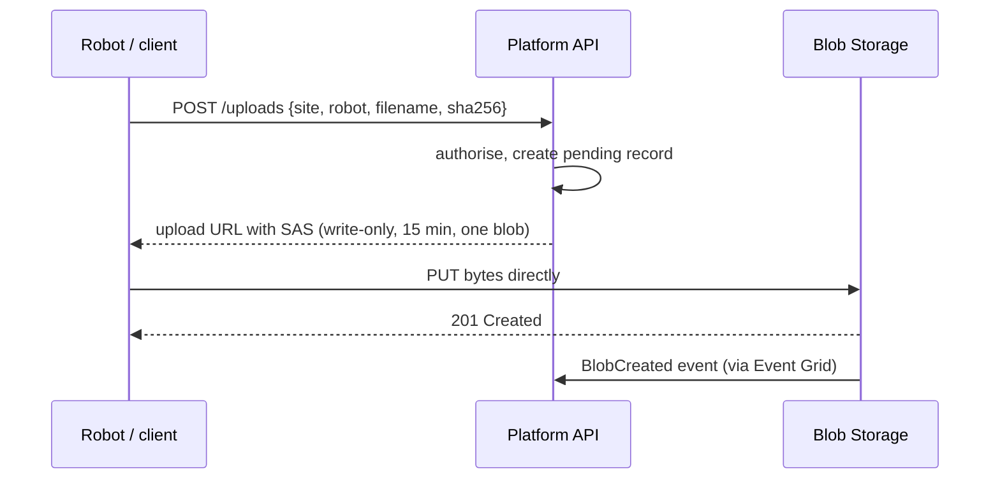

> [!summary] In one line
> Keep big files in **object storage**, keep **metadata** in a database, pass **references** (not bytes) between services, and let clients upload and download **directly** with short-lived signed URLs.

## The idea

Blob/object storage (Azure Blob, S3, GCS) is cheap, durable and massively scalable for large immutable files. It's bad at queries, small random updates and listing millions of objects quickly. So the standard split is:

| Store | Holds | Good at |
| --- | --- | --- |
| **Blob Storage** | Image bytes, point clouds, model weights, dataset exports | Durable bulk storage, streaming large files |
| **Database (MongoDB)** | Image ID, path, size, hash, site, timestamps, labels, status | Querying, filtering, joins/lookups |
| **Messages** | Image ID + blob path | Telling others something happened |

## How it works

### Pattern 1: Valet key (direct upload / download with SAS)

Don't stream large files through your API:



The API stays small and fast; Blob handles the heavy bandwidth. Prefer **user-delegation SAS** (signed with Entra ID) over account-key SAS, keep expiry short and scope narrow.

### Pattern 2: Claim check

Messages carry a **pointer**, not the payload: `{"imageId": "…", "blob": "raw/site-07/2026/11/16/…jpg"}`. Message brokers have size limits, and copying megabytes through queues is slow and costly. See [[06 Message Queues and Pub-Sub]].

### Pattern 3: Large uploads in chunks

Large files (multi-GB point clouds, dataset archives) are uploaded as **blocks** in parallel and then committed. The Azure SDKs do this automatically (`upload_blob` with `max_concurrency`). Interrupted uploads can resume by re-sending missing blocks.

### Pattern 4: Naming and layout

Choose paths for **lifecycle rules, access scoping and listing**, not human browsing:

```text
raw/{site}/{yyyy}/{mm}/{dd}/{imageId}.jpg
processed/{datasetVersion}/{split}/{imageId}.jpg
quarantine/{yyyy}/{mm}/{dd}/{imageId}.jpg
models/{modelName}/{version}/weights.pt
```

- Separate **containers** (or prefixes) per stage, so permissions and lifecycle policies differ.
- Treat raw blobs as **immutable**: never overwrite; new data, new name.
- **ADLS Gen2 (hierarchical namespace)** gives real directories and faster rename/list, useful for big analytics and ML datasets.

### Pattern 5: Tiering and lifecycle

| Tier | Use | Note |
| --- | --- | --- |
| **Hot** | Recent images being annotated and trained on | Highest storage cost, cheapest access |
| **Cool** | Older images, occasional retraining | Cheaper storage, access costs more; minimum retention period applies |
| **Cold** | Rarely used, but must be online | Cheaper still; longer minimum retention |
| **Archive** | Compliance and long-term keep | Cheapest; **offline**, rehydration takes hours |

**Lifecycle management policies** move blobs automatically, e.g. *raw → cool after 30 days → archive after 180 days → delete after 2 years*.

### Pattern 6: Integrity and protection

- Store a **content hash** (SHA-256) in metadata, verify on read, use it for deduplication and as the ID ([[09 Idempotency, Retries and Timeouts]]).
- Enable **soft delete** and **versioning** to recover from mistakes; consider **immutability policies** for audit data.
- Access with **managed identities** and RBAC; no account keys in code.
- **Private endpoints** if the data must not cross the public internet.

## On the platform

- With ~9 TB/day in the [[02 Back-of-Envelope Estimation|estimate]], **tiering and retention decide the bill**. A lifecycle policy is likely the single cheapest big win.
- Kubeflow training steps should read **dataset manifests** (lists of blob paths + hashes) rather than "all files in a folder", so datasets are reproducible and versionable.
- For 3D data, chunk and compress (e.g. compressed point-cloud formats), and consider keeping downsampled versions hot.
- Thumbnails for the review UI: generate once, store under `thumbs/`, serve through a CDN ([[05 Caching]]).

## Common mistakes

- Uploading through the API server, so memory and timeouts blow up under load.
- Long-lived, broad SAS tokens shared in scripts.
- Listing a container with millions of blobs to find "new" files. Use events or a metadata DB instead.
- Moving data to archive and later needing it for retraining tomorrow.
- Overwriting raw blobs, which breaks reproducibility.

## Check yourself

> [!question]- What is the valet key pattern and why use it?
> The API issues a short-lived, narrowly scoped signed URL (SAS) so the client uploads/downloads directly to storage. It keeps large transfers off the API and limits what the client can do.

> [!question]- What does the claim-check pattern put in a message?
> A reference (ID and blob path) to the data, not the data itself.

> [!question]- Why is the archive tier risky for training data?
> It's offline; rehydration takes hours and costs money, so it's wrong for anything that may be needed for retraining soon.

## Apply it

- [ ] Find the platform's current Blob layout, tiers and lifecycle policies. Is anything older than 90 days still in hot?
- [ ] In the capstone (January): implement a SAS-based upload endpoint and a BlobCreated-triggered validator.

## Go deeper

- [Azure: Valet Key pattern](https://learn.microsoft.com/en-us/azure/architecture/patterns/valet-key)
- [Azure: Claim-Check pattern](https://learn.microsoft.com/en-us/azure/architecture/patterns/claim-check)
- [Azure Blob: Access tiers](https://learn.microsoft.com/en-us/azure/storage/blobs/access-tiers-overview)
- [Azure Blob: Lifecycle management](https://learn.microsoft.com/en-us/azure/storage/blobs/lifecycle-management-overview)

**Related:** [[06 Message Queues and Pub-Sub]] · [[02 Back-of-Envelope Estimation]] · [[09 Idempotency, Retries and Timeouts]]
