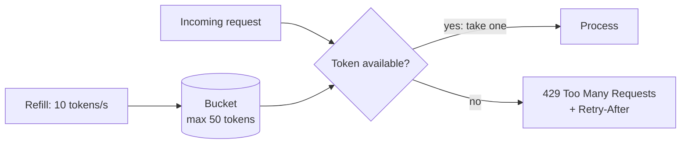

> [!summary] In one line
> Rate limiting caps how many requests a client may make in a time window, so one noisy client, buggy script or retry storm can't take the service down for everyone.

## The idea

Two sides to know:

1. **Limiting others** (inbound): protect *your* API from overload and unfair use.
2. **Being limited** (outbound): respect *other people's* limits (V7, Azure OpenAI, Azure management APIs) so your jobs don't fail or get blocked.

Rate limiting is also a **cost control** for anything pay-per-call, such as LLM APIs.

## How it works

### Algorithms

| Algorithm | How | Pros / cons |
| --- | --- | --- |
| **Fixed window** | Count per minute; reset on the minute | Simple; allows 2× burst at window edges |
| **Sliding window** | Count over the last 60 s, rolling | Smoother; a bit more state |
| **Token bucket** | Bucket holds up to *B* tokens, refilled at *r*/s; each request takes one | Allows short **bursts** up to *B*, enforces average *r*. **The most common choice** |
| **Leaky bucket** | Requests drain from a queue at a fixed rate | Smooth output rate; adds queueing delay |

### What to limit by

Per **API key / client ID**, per **user**, per **IP** (weak, because of NATs and proxies), per **endpoint** (expensive endpoints get lower limits), or globally.

### Responding properly

- Return **HTTP 429 Too Many Requests**.
- Include **`Retry-After`** and, ideally, headers like `RateLimit-Limit`, `RateLimit-Remaining`, `RateLimit-Reset`.
- Clients should back off and retry with jitter ([[09 Idempotency, Retries and Timeouts]]).

### Where to enforce it

- **At the edge / gateway** (API Management `rate-limit-by-key`, Front Door WAF rules) is easiest and keeps junk off your services. See [[04 Load Balancing and API Gateways]].
- **In the service** for business rules ("max 3 concurrent training jobs per team").
- **Distributed counters** (e.g. Redis) when many instances must share one limit.

### Related controls

- **Quotas:** total per day/month (e.g. GPU-hours per team).
- **Concurrency limits:** max in-flight jobs, not requests per second.
- **Load shedding:** under overload, reject low-priority work first to keep critical paths alive.
- **Backpressure:** queues absorb bursts; consumers pull at their own rate ([[06 Message Queues and Pub-Sub]]).

## On the platform

- **Inbound:** robot fleets or scripts that misbehave (a reconnect loop re-uploading everything) → per-robot / per-client limits on the upload-URL endpoint.
- **Expensive actions:** cap concurrent training jobs per team or project, a quota on GPU-hours.
- **Outbound to V7:** respect its API limits; a client-side **token bucket** in the sync worker smooths bursts, and 429s are retried with backoff.
- **Outbound to LLM APIs** (for the GenAI win in month 6): limits are in requests *and tokens* per minute; budget both, and add a cost cap.

## Common mistakes

- No limits on internal APIs ("only our own tools call it") until a script loops.
- Returning 500 or 503 instead of 429, so clients can't tell they should slow down.
- Limits only per IP, so everyone behind a corporate NAT shares one bucket.
- Clients retrying 429s immediately, which makes it worse.

## Check yourself

> [!question]- How does a token bucket allow bursts but still enforce an average rate?
> The bucket can hold up to B tokens, so a client can briefly spend B requests at once, but tokens refill only at rate r, so the long-run average can't exceed r.

> [!question]- What status code and header should a rate-limited response include?
> HTTP 429 Too Many Requests, with a Retry-After header.

> [!question]- Why does rate limiting matter for LLM-based features?
> Providers limit requests and tokens per minute, and each call costs money. Limits protect both reliability and budget.

## Apply it

- [ ] List the external APIs the platform calls (V7, Azure, others) and their documented limits. Do our clients handle 429s?
- [ ] Ask: is there any limit on how many training jobs one person can start?

## Go deeper

- [Azure: Rate Limiting pattern](https://learn.microsoft.com/en-us/azure/architecture/patterns/rate-limiting-pattern)
- [Azure: Throttling pattern](https://learn.microsoft.com/en-us/azure/architecture/patterns/throttling)
- [Azure API Management: rate-limit-by-key policy](https://learn.microsoft.com/en-us/azure/api-management/rate-limit-by-key-policy)

**Related:** [[09 Idempotency, Retries and Timeouts]] · [[04 Load Balancing and API Gateways]] · [[06 Message Queues and Pub-Sub]]
