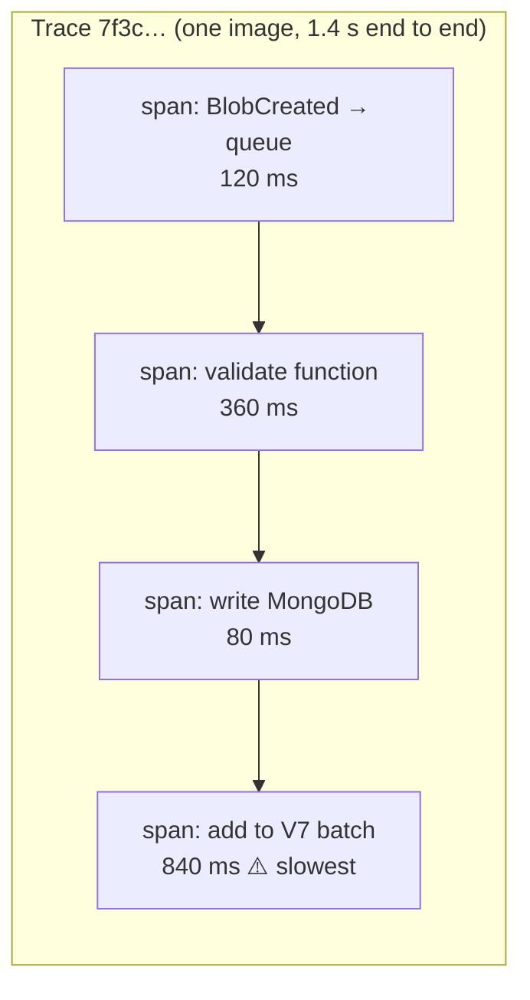

> [!summary] In one line
> **Metrics** tell you *something* is wrong, **traces** show *where*, and **logs** explain *why*. Good observability lets you answer new questions about the system without shipping new code.

## The idea

| Signal | What it is | Example | Good for |
| --- | --- | --- | --- |
| **Metrics** | Numbers over time, cheap to store | `images_validated_total`, queue length, p95 latency | Dashboards, alerts, trends, KPIs |
| **Logs** | Timestamped events with context | `{"level":"error","imageId":"…","reason":"corrupt"}` | Explaining specific failures |
| **Traces** | One request's path across services, as timed spans | Upload → validate → metadata → annotation batch | Finding slow or failing hops in distributed flows |

**Monitoring** = watching known failure modes (dashboards, alerts). **Observability** = being able to investigate unknown ones.

## How it works

### What to measure: two quick frameworks

- **RED** (for services): **R**ate, **E**rrors, **D**uration of requests.
- **USE** (for resources): **U**tilisation, **S**aturation, **E**rrors of CPU, memory, GPU, disk, queues.
- Google's **four golden signals**: latency, traffic, errors, saturation.

For async systems add: **queue length**, **age of oldest message**, **DLQ count**, **end-to-end processing lag**.

### Structured logging

Log JSON, not prose, with consistent fields:

```python
import structlog  # emits JSON when configured with JSONRenderer
log = structlog.get_logger("ingest")

log.info("image_validated",
         image_id=image_id,
         site_id=site_id,
         correlation_id=correlation_id,
         duration_ms=182,
         result="accepted")
```

Rules: include **correlation ID** in every line; use **levels** properly (ERROR = someone should look); never log **secrets or personal data**; don't log every success at high volume (use metrics for that).

### Distributed tracing



- A **trace** = one end-to-end operation; **spans** = timed steps within it.
- **Context propagation:** the trace ID travels in HTTP headers (W3C `traceparent`) and in **message properties**, so async hops stay connected.
- **OpenTelemetry** is the vendor-neutral standard for emitting metrics, logs and traces; **Azure Monitor / Application Insights** can receive it (the Azure Monitor OpenTelemetry distro for Python sets this up).

### Alerting that people trust

- Alert on **symptoms users feel** (error rate, latency, processing lag, DLQ > 0), not on every CPU spike.
- Tie alerts to **SLOs** ([[01 Requirements]]): "ingestion lag p95 > 60 s for 10 min".
- Every alert needs an **owner** and a **runbook link**. If nobody acts on an alert, delete it.

## On the platform

Observability is also how the **platform KPIs** from the roadmap get reported from real data:

| KPI | Signal |
| --- | --- |
| Turnaround: raw image → trained → deployed | Timestamps per stage (metrics or events), traced by dataset/model version |
| Annotation cost and quality per batch | Batch metrics from V7 sync + review results |
| Model evaluation pass rate | Pipeline step metrics, model registry |
| Deployment frequency | CI/CD events (GitHub Actions) |
| Ingestion health | Images/min, rejection rate by reason, queue lag, DLQ count |

Also monitor **ML-specific** signals later (months 8+): data drift, prediction confidence distribution, GPU utilisation per job.

## Common mistakes

- Logs without correlation IDs, which can't be stitched together.
- Unstructured logs, so you can't query "all failures for site 7 yesterday".
- Hundreds of noisy alerts, so people ignore the important one.
- Dashboards of infrastructure metrics with **no business view** (images processed, models shipped).
- Logging full payloads or tokens.

## Check yourself

> [!question]- What does each of the three signals answer?
> Metrics: is something wrong, and how much? Traces: where in the flow? Logs: what exactly happened, and why?

> [!question]- What are the RED metrics?
> Rate (requests per second), Errors (failed requests), Duration (latency distribution).

> [!question]- How does a trace survive an asynchronous queue hop?
> The producer puts the trace context (trace ID, span ID) into the message properties; the consumer extracts it and continues the trace.

> [!question]- What makes an alert worth keeping?
> It reflects user-visible impact, is actionable, has an owner and a runbook, and doesn't fire constantly for nothing.

## Apply it

- [ ] Find where platform logs and metrics go today (Application Insights? Log Analytics? Grafana?). Can I query all events for one image ID?
- [ ] Draft the **platform KPI dashboard** (month-1 deliverable): which KPI, which signal, does the data exist yet?

## Go deeper

- [Google SRE Book: Monitoring Distributed Systems](https://sre.google/sre-book/monitoring-distributed-systems/)
- [OpenTelemetry: Concepts](https://opentelemetry.io/docs/concepts/)
- [Azure Monitor OpenTelemetry for Python](https://learn.microsoft.com/en-us/azure/azure-monitor/app/opentelemetry-enable?tabs=python)

**Related:** [[01 Requirements]] · [[06 Message Queues and Pub-Sub]] · [[04 Quality Attributes]]
