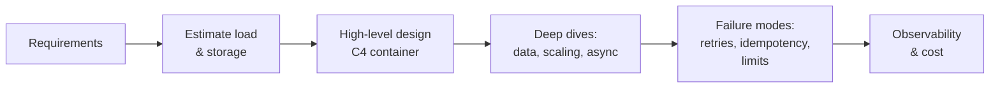

> [!abstract] Why this section
> System design is architecture under **load and failure**: how a system behaves when there's ten times more data, when a node dies, or when a message arrives twice. These twelve chapters cover the building blocks that appear in every real design discussion and every design interview.

## Chapters (in learning order)

- [ ] [[01 Requirements]]: functional vs non-functional requirements
- [ ] [[02 Back-of-Envelope Estimation]]: quick capacity maths
- [ ] [[03 Vertical vs Horizontal Scaling]]
- [ ] [[04 Load Balancing and API Gateways]]
- [ ] [[05 Caching]]: strategies and invalidation
- [ ] [[06 Message Queues and Pub-Sub]]
- [ ] [[07 Replication, Partitioning and Sharding]]
- [ ] [[08 CAP Theorem and Consistency]]: consistency models
- [ ] [[09 Idempotency, Retries and Timeouts]]
- [ ] [[10 Blob Storage Patterns]]: large files
- [ ] [[11 Rate Limiting]]
- [ ] [[12 Monitoring, Logging and Tracing]]: observability basics

## A design conversation, in order

Use this order in design reviews and interviews. Most bad designs come from skipping the first two steps.

## The building blocks map

| Problem | Building block |
| --- | --- |
| Too much load for one machine | [[03 Vertical vs Horizontal Scaling\|Horizontal scaling]] + [[04 Load Balancing and API Gateways\|load balancing]] |
| Repeated expensive reads | [[05 Caching\|Caching]] |
| Spiky or slow work | [[06 Message Queues and Pub-Sub\|Queues]] |
| Too much data for one database | [[07 Replication, Partitioning and Sharding\|Partitioning]] |
| Node failures | [[07 Replication, Partitioning and Sharding\|Replication]] + [[09 Idempotency, Retries and Timeouts\|retries]] |
| Huge files | [[10 Blob Storage Patterns\|Blob storage patterns]] |
| Abusive or runaway clients | [[11 Rate Limiting\|Rate limiting]] |
| "What just happened?" | [[12 Monitoring, Logging and Tracing\|Observability]] |

## Main resources

- *Designing Data-Intensive Applications* (Kleppmann): Ch. 1, 5, 6, 8, 9 map to these chapters
- [Azure Cloud Design Patterns](https://learn.microsoft.com/en-us/azure/architecture/patterns/)
- [The System Design Primer](https://github.com/donnemartin/system-design-primer): a free overview with exercises
