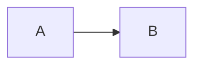

> [!summary] In one line
> …

## The idea

## How it works

## On the platform

How this shows up in the image → annotation → training → deployment pipeline.

## Trade-offs

| Choose this when… | Avoid it when… |
| --- | --- |
| | |

## Common mistakes

-

## Check yourself

> [!question]- Question one?
> Answer.

## Apply it

- [ ] One small task for the capstone or at work.

## Go deeper

-

**Related:** [[]]
